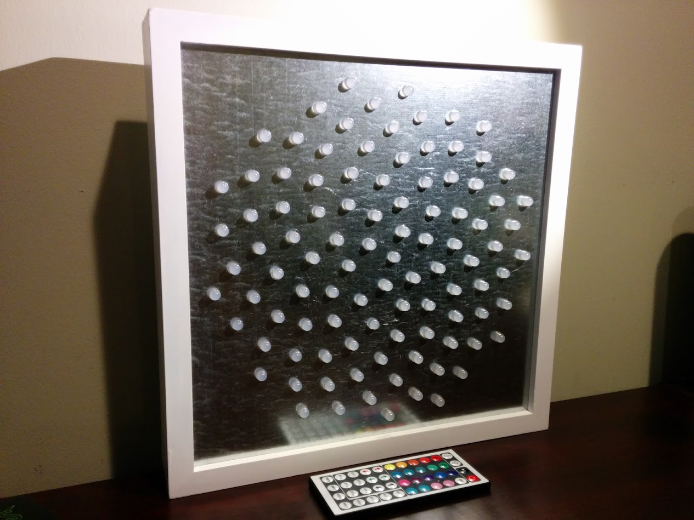

 

Fibonacci v2 is a beautiful light art display. Swirling and pulsing like a colorful galaxy, it's mesmerizing to watch.

It consists of 100 RGB LEDs, arranged into a <a href="https://en.wikipedia.org/wiki/Fermat%27s_spiral">Fermat's spiral</a> pattern.



  

    

      
      

        <a href="https://goo.gl/photos/TA2RXFS82G9uapnJA">More pictures and details</a>
      

    

  

