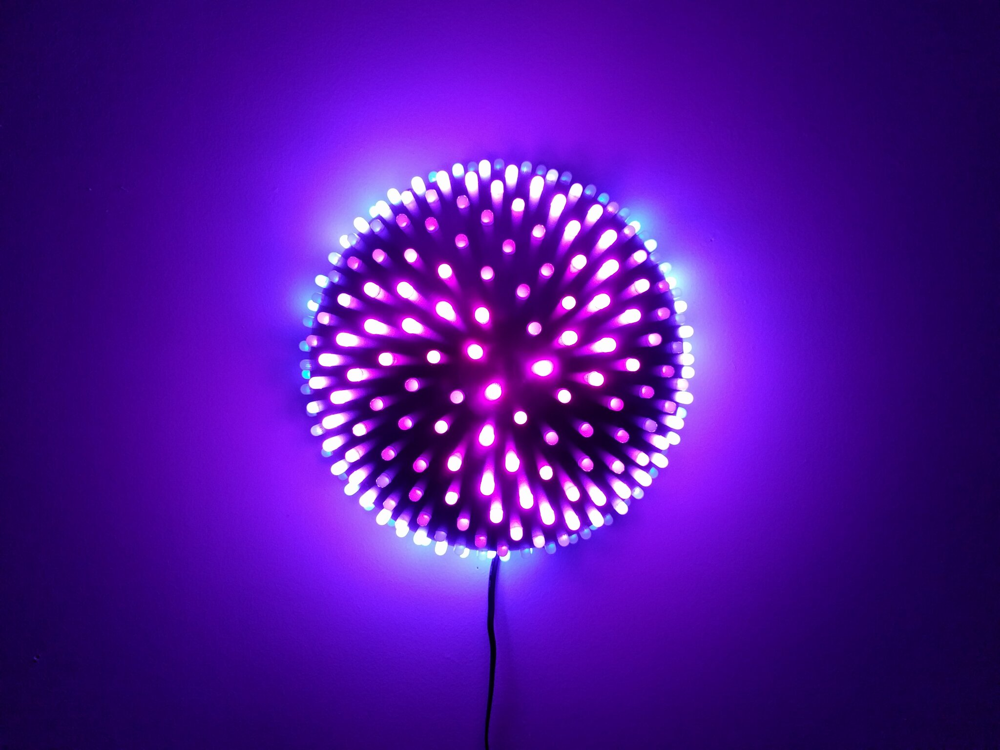

Ducenti (Lux Phyllotaxis) is a beautiful 11" stainless steel hemispherical light art display. Swirling and pulsing like a colorful galaxy, it's mesmerizing to watch.

It consists of 200 RGB LEDs, arranged into a spherical <a href="https://en.wikipedia.org/wiki/Fermat%27s_spiral">Fermat's spiral</a> pattern.



  

    

      
      

        <a href="https://goo.gl/photos/VTCBmkZ8aZh4pSj79">More pictures and details</a>
      

    

  

