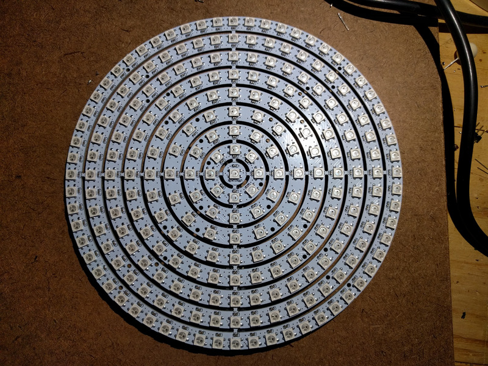
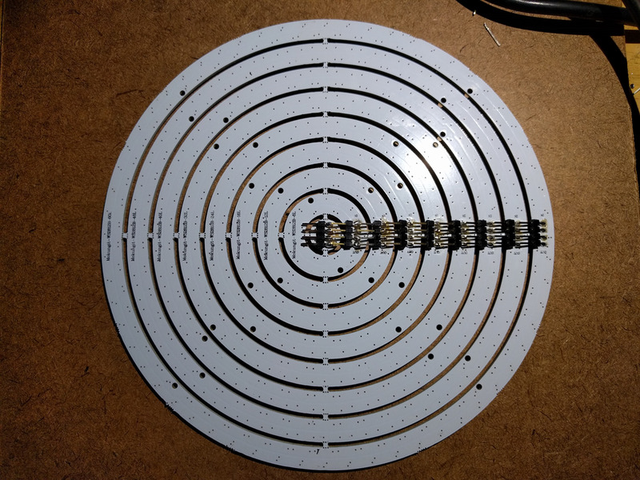
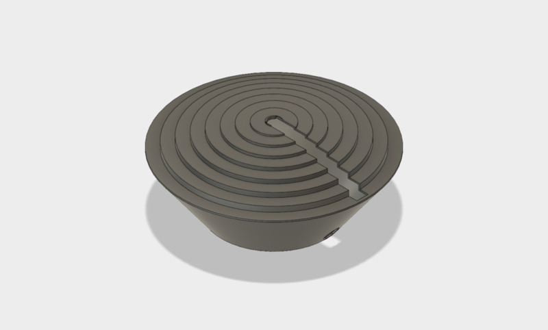
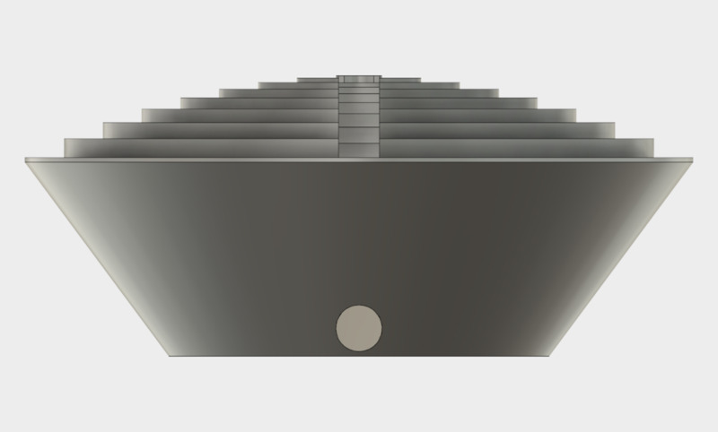

Dome-shaped, wall-hung frosted glass and metal, with an inner 3D printed frame for 240 RGB LEDs. Driven by an ESP8266 microcontroller using the FastLED library, controlled with a web app over WiFi and/or an infrared remote control.

## Features:

- Control via a web app over Wi-Fi
- Control via an infrared (wireless) remote control
- On/Off
- Adjustable brightness
- Choose animation/pattern
- Set to any solid color
- Autoplay with adjustable duration

## Construction

Inner frame:

  

    
  

  

    
  

  

    
  

  

    
  

  

    <video playsinline class="post lazy" autoplay="autoplay" muted="muted" loop="loop" data-src="/assets/a5fB884.mp4"></video>
  

