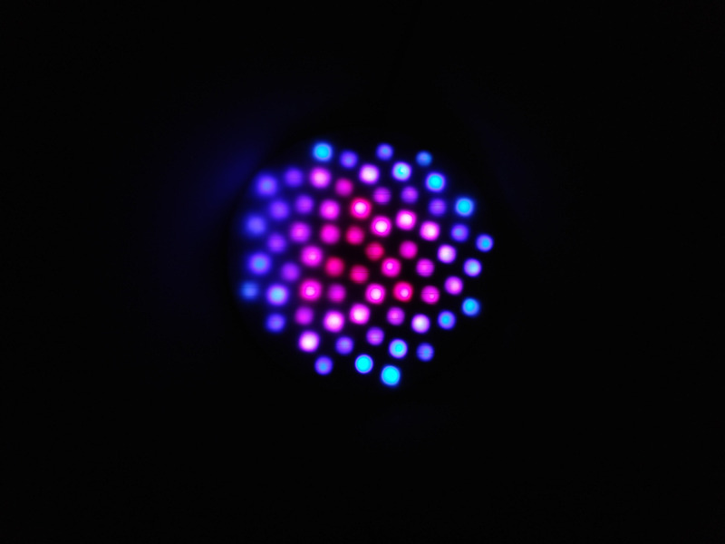
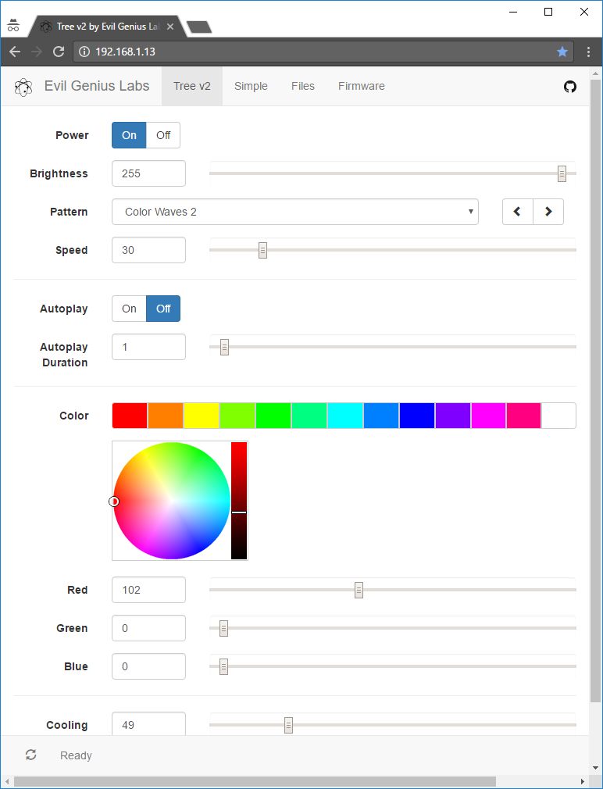
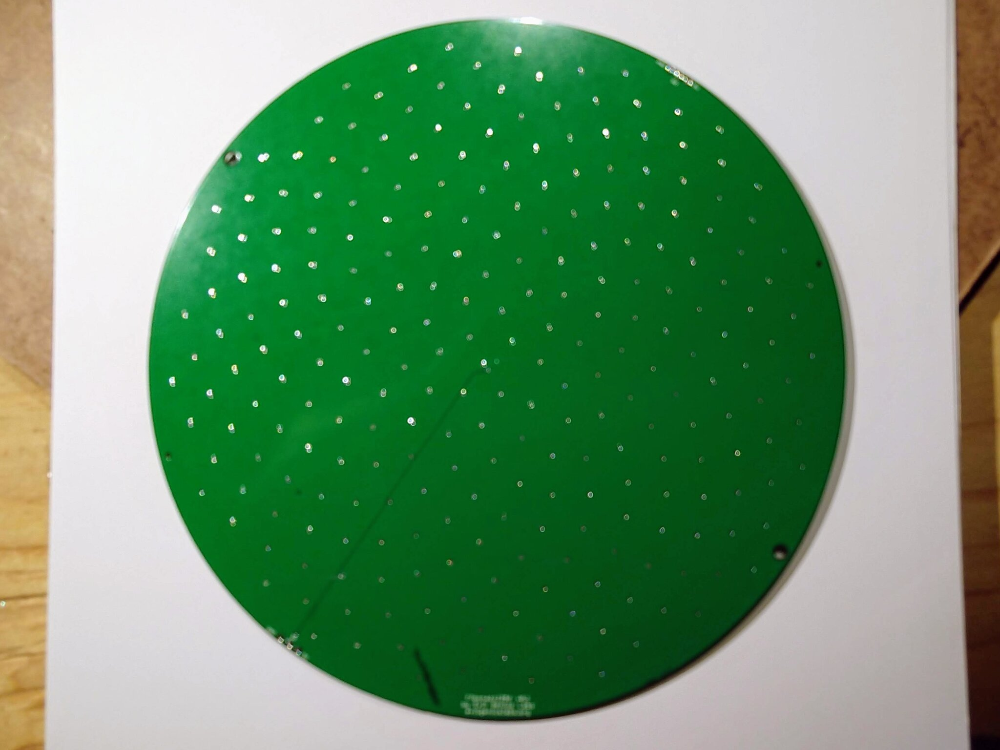
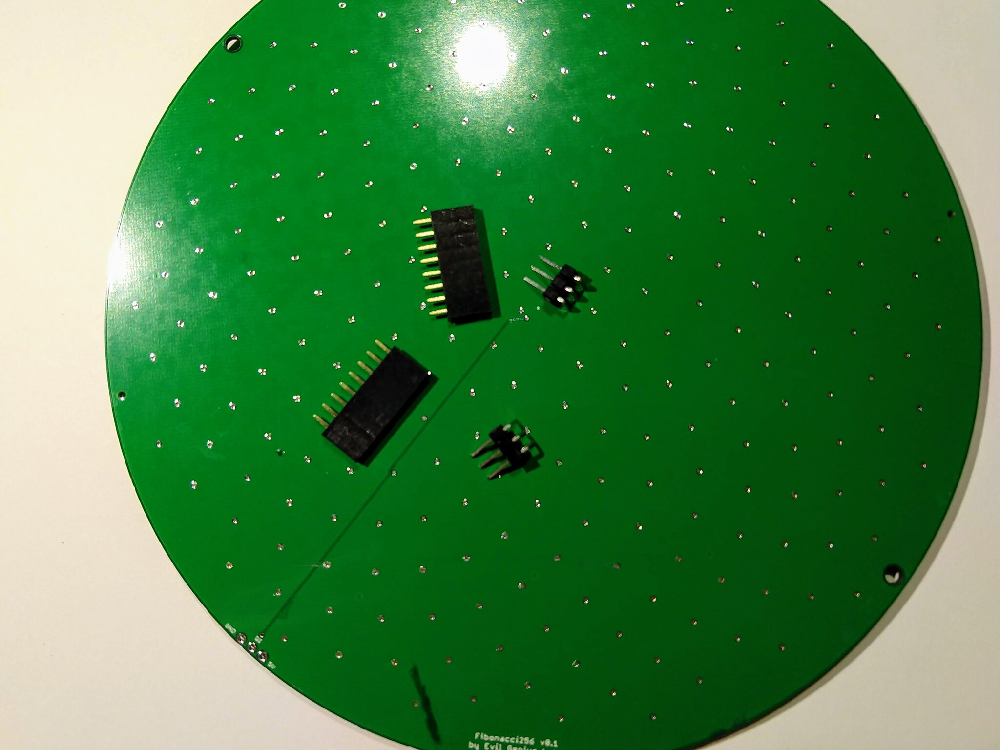
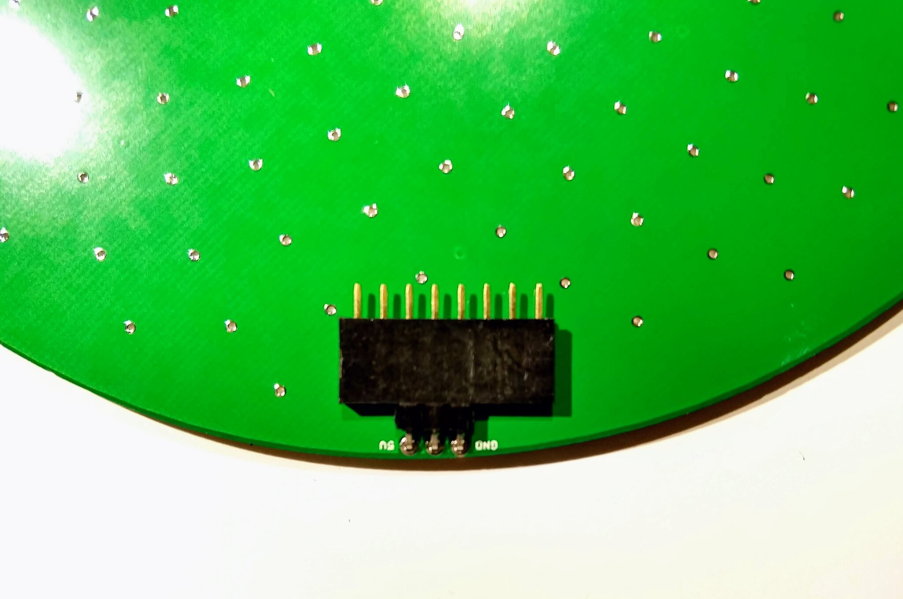
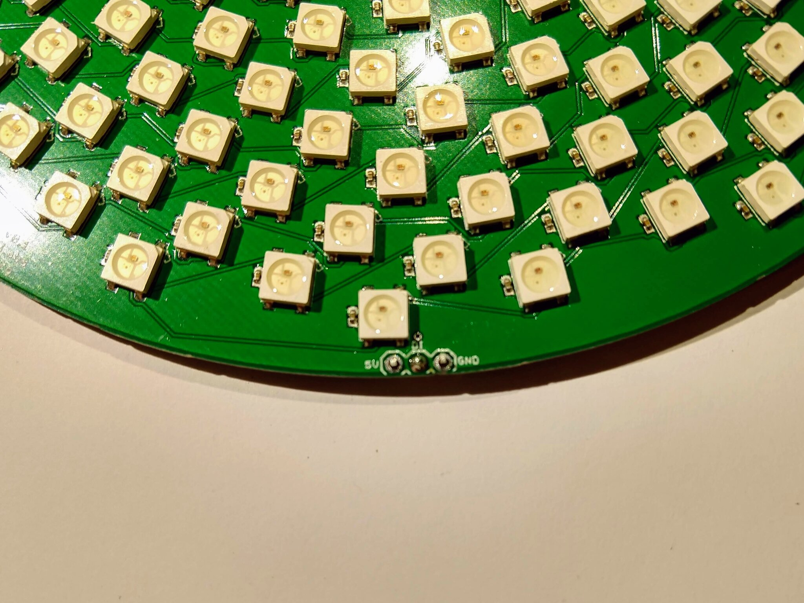
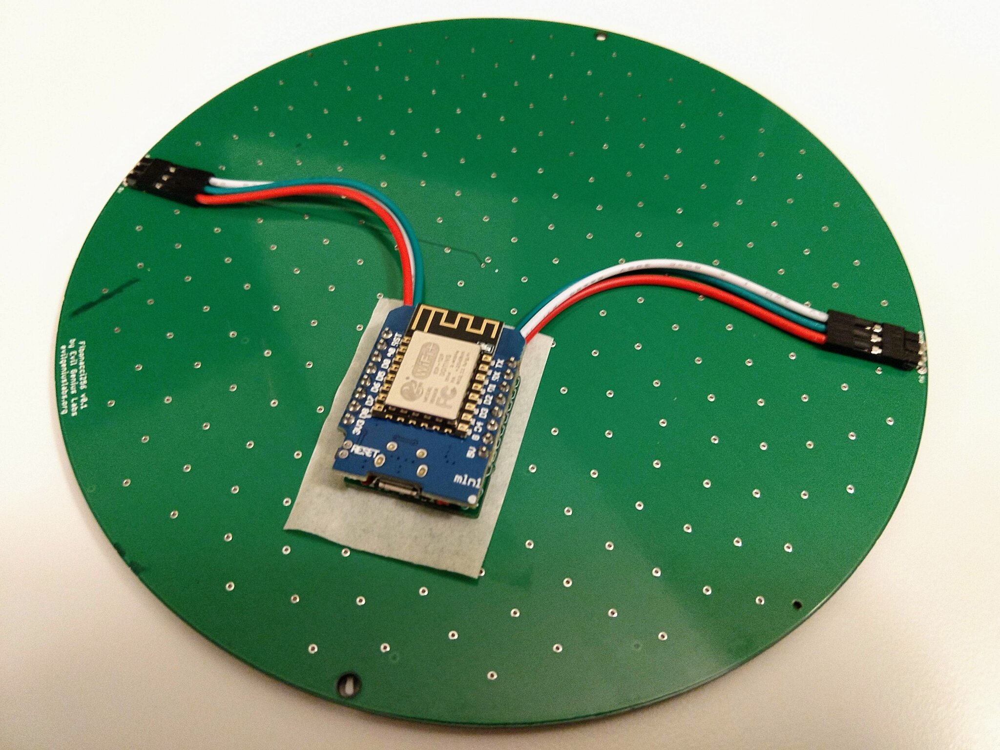

<!-- <a href="/assets/9wXGJhP.mp4" target="_blank"><video class="lazy" style="width:340px" data-src="/assets/9wXGJhP.mp4" autoplay muted loop playsinline></video></a> -->

---

**Retired**

Alternatives:

- [One Inch Fibonacci32](/one-inch-fibonacci32)

---

<h2>Table of Contents</h2>

- TOC
{:toc}

## Details

Fibonacci32 is a beautiful 86mm circular disc with 34 RGB LEDs surface mounted in a Fibonacci distribution. Swirling and pulsing like a colorful galaxy, it's mesmerizing to watch.

It consists of 34 RGB LEDs, arranged into a circular <a href="https://en.wikipedia.org/wiki/Fermat%27s_spiral">Fermat's spiral</a> pattern. I decided to include 34 LEDs since it's a number in the Fibonacci sequence, only 2 away from 32, and there was room on the 50mm PCB. I'm calling it Fibonacci32 so that it fits in with the rest of the series.



---

  

    

      

        <a href="https://photos.app.goo.gl/sxWebS7FVF1jFhfLA" target="_blank">More pictures and details:</a>
      

      
    

  

## Connecting

Instructions for connecting to a Fibonacci, pre-assembled or programmed with the [ESP8266-FastLED-WebServer](https://github.com/jasoncoon/esp8266-fastled-webserver/tree/fibonacci32mini) code:

1. Peel and remove any plastic film and/or paper from the acrylic front and back. This was left on to protect your Fibonacci’s acrylic during shipping.
1. Connect the MicroUSB port with a cable to a USB port, power adapter, etc.
1. Once powered on, it will create a WiFi network named `Fibonacci32-XXXX`, where XXXX are four letters/numbers unique to your Fibonacci. Please note this name for step 7 below.
1. Connect to this network with a phone, laptop, etc. You should get redirected, or prompted to sign in.
1. In the WiFi Manager page, click `Configure WiFi`.
1. Choose your WiFi network from the list, or enter its SSID manually, if needed. Enter your network's password. Click Save.
1. It will save, restart, and your device (phone, laptop, etc) should reconnect to your WiFi network. Do so manually, if needed.
1. On your device, browse to https://discover.evilgeniuslabs.org/. You should see your Fibonacci listed. Click it's `IP Address` link.
1. You should now be able to control your Fibonacci via the web page.
1. If this does not work, you may need to consult your WiFI AP/router documentation to find your Fibonacci’s IP address, or contact me for assistance.

## Specifications

- Size: 1.98 x 1.98 x .063 inch (50.2 x 50.2 mm x 1.6mm)
- 2 layer printed circuit board
- FR4 substrate
- Green SMOBC (solder mask over bare copper)
- HASL (Hot Air Solder Leveling) Finish
- Designed in the US by Evil Genius Labs
- Some PCBs are manufactured in the US by [OSH Park](https://oshpark.com) in their [After Dark](https://docs.oshpark.com/services/afterdark) (clear soldermask on a black substrate for stylish boards) finish!
- Some are assembled in the US by Evil Genius Labs

**Parts**

**Includes only the printed circuit board with LEDs**, does not include parts that are required to assemble and run it (microcontroller, power supply, wires, etc).

Parts that are **not included**, but are required to assemble and use:

- Microcontroller (Arduino, ESP8266, ESP32, etc):
  - [Pixelblaze](https://www.bhencke.com/pixelblaze) by [ElectroMage](https://electromage.com)
- Power supply, or run off of USB power from microcontroller.
- Wires, connectors, crimp tool, etc.
- Soldering iron, solder, etc.

Parts I used in my builds (also **not included**):

- [Wemos D1 Mini ESP8266 Level Shifter Mini Shield Kit](https://oshpark.com/shared_projects/6tHcl6u3) is a great option. It's what I used to use in all my builds.
- USB power from microcontroller, with [FastLED's power management](https://github.com/FastLED/FastLED/wiki/Power-notes#managing-power-in-fastled) to limit the maximum brightness and keep total current draw under 2A.
- [Dupont Connector Pins](https://amzn.to/2IiN84D)
- [Dupont Connector Housings](https://amzn.to/39pjZRk)
- [Dupont Crimper Tool](https://amzn.to/3cy1z2P)
- [24AWG Stranded Wire](https://amzn.to/2wpw1vj)
- [90 Degree Header Pins](https://amzn.to/2TnyDmx)

## Code

Open source example firmware and web application: [https://github.com/jasoncoon/esp8266-fastled-webserver/tree/fibonacci32mini](https://github.com/jasoncoon/esp8266-fastled-webserver/tree/fibonacci32mini)

## Assembly Instructions

**Note**: Double-check the position, alignment, and orientation of each component very carefully before soldering!

If you're new to soldering, I highly recommend reading through a good soldering tutorial, such as the ones by [Adafruit](https://learn.adafruit.com/adafruit-guide-excellent-soldering) and [SparkFun](https://learn.sparkfun.com/tutorials/how-to-solder-through-hole-soldering).

**Note**: Pictures are of the larger [Fibonacci256](/fibonacci256), but the instructions are identical.

1. Find a clean spot on your soldering workspace. I used a piece of heavy card stock. Carefully place the board with the LEDs facing down and the bottom of the board facing up.
   
2. I used [90 degree header pins](https://amzn.to/2Vzi2gU) to allow connecting and disconnecting jumper wires easily. I used small [female headers](https://amzn.to/2Vzi2gU) to keep them level while I soldered.
   
3. Insert the header pins.
   
4. Carefully turn the board over and solder only the middle pin of each header.
   
5. Ensure the headers are straight and level before proceeding to solder the remaining pins. The 5V and GND pins are connected to planes with large traces, and may take some time to heat up enough for solder to melt. Using a higher temperature and less time can help, if possible. Flux can also help.
6. Check each solder joint, then disconnect the female headers.
7. **VERY** carefully check polarity before connecting 5V and GND. If possible, connect 5V and GND on both sets of headers to provide maximum current flow and minimize voltage drop. I used [female jumper wires](https://amzn.to/2vjvZ8e).
   
8. Connect the data pin from your microcontroller to the DI pin on the Fibonacci board.
9. Each WS2812 can theoretically draw 60mA at full brightness, solid white color. 32 of them can theoretically draw 2.04 Amps! I strongly suggest using [FastLED's power management](https://github.com/FastLED/FastLED/wiki/Power-notes#managing-power-in-fastled) to limit the maximum brightness to a reasonable amount, well under the maximum your power supply is rated for. I've found even just 2A from a USB power adapter is blindingly bright.
10. Keep an eye on the temperature of the PCB and especially the connectors. High temperatures can reduce the life of the LEDs. When possible, ensure air can flow, either passively (ventilation) or actively (exhaust fan).
11. Most header pins are rated for 4-6 amps, but be sure to check your pins and wires. High temperatures increase resistance, which increases temperature, ad infinitum. If temperatures exceed the maximum rating of the wire insulation, sparks and fire can occur at high amperage.
