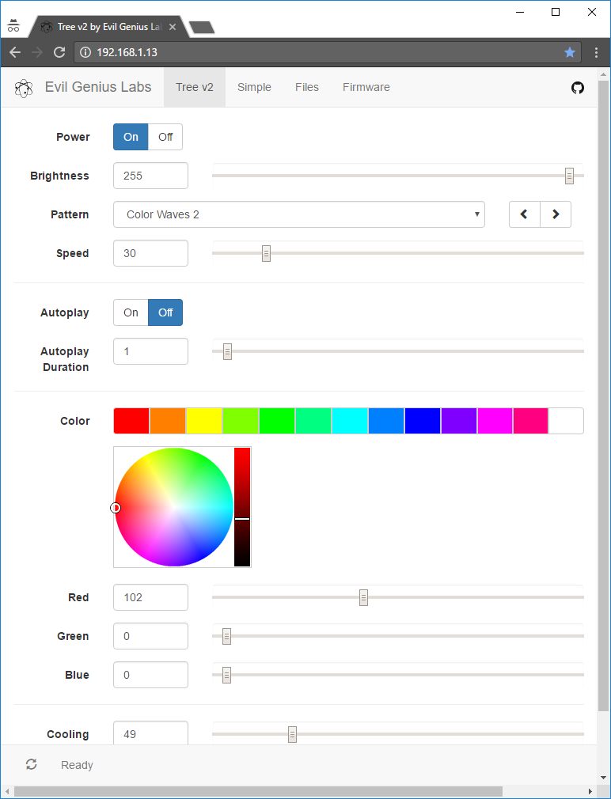

---

**Retired**

Alternatives:

- [Fibonacc512 HDR Pixelblaze](/fibonacci512-hdr-pixelblaze)

---

<h3>Table of Contents</h3>

- TOC
{:toc}

### Details

Fibonacci512 is a giant, beautiful 320mm circular disc with 512 RGB LEDs surface mounted in a Fibonacci distribution. Swirling and pulsing like a colorful galaxy, it's mesmerizing to watch.

It consists of 512 WS2812B-Mini 3535 RGB LEDs, arranged into a circular <a href="https://en.wikipedia.org/wiki/Fermat%27s_spiral">Fermat's spiral</a> pattern.

I have created several LED art pieces in Fibonacci patterns. They are all very labor intensive to create, and so are fairly expensive and limited in quantity. I wanted to come up with a Fibonacci layout that was at least slightly easier to create, and therefore more affordable.

I have RGB LEDs in just about every form they come: strips, strings, rings, discs, etc. The LEDs on most discs are arranged in very regular rings. Fibonacci512 is different. The LEDs are arranged in a Fibonacci distribution. The makes the layout very organic and seemingly messy. But with the proper animation, spiral patterns emerge with spectacular results.

Each of the 512 WS2812B-Mini 3535 RGB LEDs has its own decoupling capacitor built in. The top and bottom of the PCB are large 5V and GND planes, to allow for the large amount of current required by the 512 LEDs. The PCB is split into four separate data lines to allow for higher frame rates when driven by a microcontroller that supports the FastLED library's parallel output, such as ESP8266, ESP32, Teensy, etc. The max theoretical frame rate with four way parallel output is ~260 FPS. Each of the four data lines has a separate four-pin headers provided for 5V, Data In (to the section), Data Out (from the previous section) and GND. The last Data Out pin can be used to connect to even more LEDs. There are also small jumper solder pads that can be bridged to drive the whole panel with a single pin (max ~65 FPS), or two pins (max 130 FPS).



---

### Connecting

Instructions for connecting to a Fibonacci, pre-assembled or programmed with the [ESP8266-FastLED-WebServer](https://github.com/jasoncoon/esp8266-fastled-webserver/tree/fibonacci512) code:

1. Peel and remove any plastic film and/or paper from the acrylic front and back. This was left on to protect your Fibonacci’s acrylic during shipping.
1. Connect the power extension cable to your Fibonacci. The flat part of the cable connector should face the back of the Fibonacci. Connect the extension cable to the 5V supply and plug it in to an outlet.
1. **Warning**: You can use the USB port to upload new firmware, but please lower the brightness. Extended use at high brightness can draw too much current through the USB port and damage the controller.
1. Once powered on, it will create a WiFi network named `Fibonacci512-XXXX`, where XXXX are four letters/numbers unique to your Fibonacci. Please note this name for step 7 below.
1. Connect to this network with a phone, laptop, etc. You should get redirected, or prompted to sign in.
1. In the WiFi Manager page, click `Configure WiFi`.
1. Choose your WiFi network from the list, or enter its SSID manually, if needed. Enter your network's password. Click Save.
1. It will save, restart, and your device (phone, laptop, etc) should reconnect to your WiFi network. Do so manually, if needed.
1. On your device, browse to Fibonacci512-XXXX.local (where XXXX is the same as from step 2 above).
1. You should now be able to control your Fibonacci via the web page.
1. If this does not work, you may need to consult your WiFI AP/router documentation to find your Fibonacci’s IP address, or contact me for assistance.

### Specifications

- Size: 320 x 320 x 1.6mm (12.6 x 12.6 x .063 inch)
- 2 layer printed circuit board
- FR4 substrate
- Black SMOBC (solder mask over bare copper)
- HASL (Hot Air Solder Leveling)
- Designed and assembled in the US by Evil Genius Labs

### Code

Open source example firmware and web application: [https://github.com/jasoncoon/esp8266-fastled-webserver/tree/fibonacci512mini](https://github.com/jasoncoon/esp8266-fastled-webserver/tree/fibonacci512mini)

