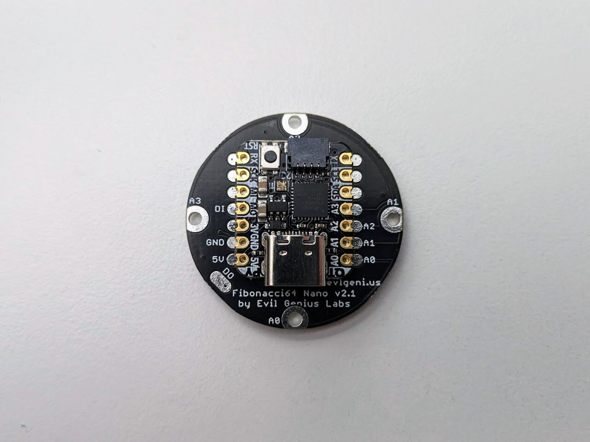
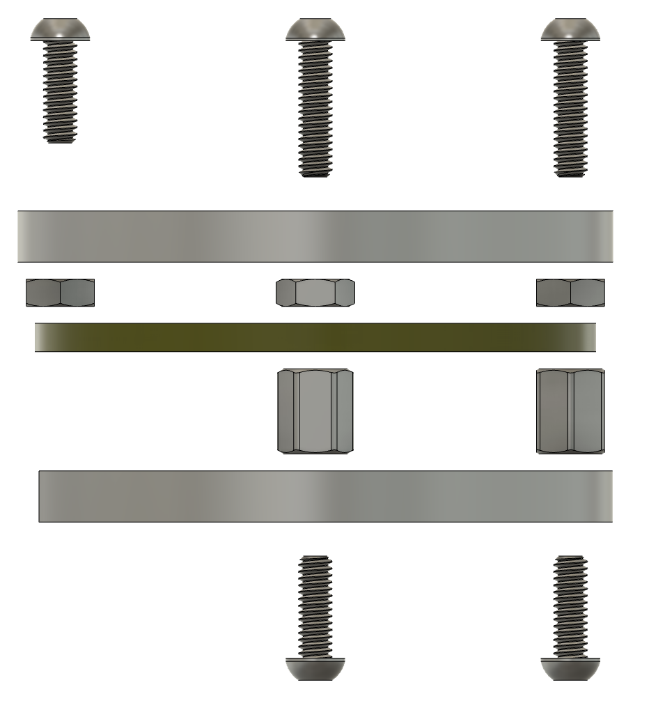
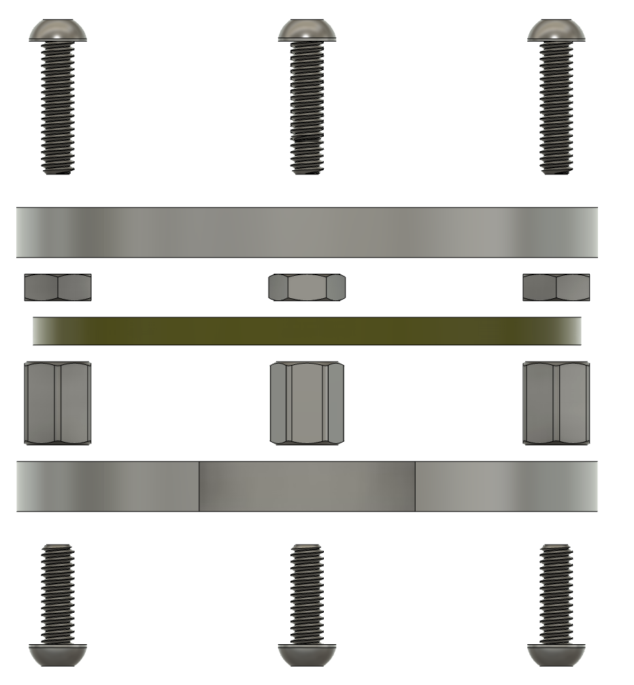
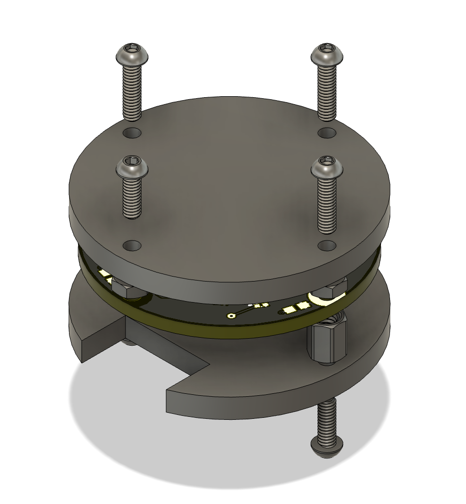
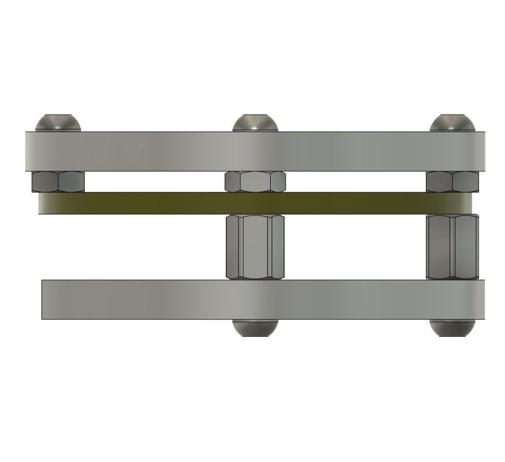
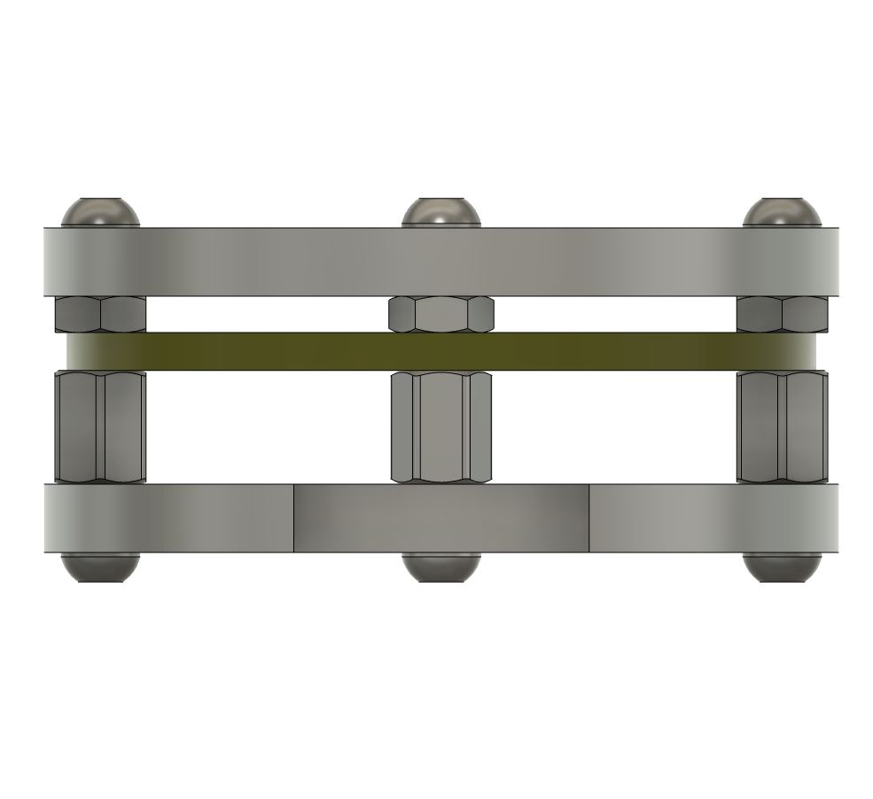
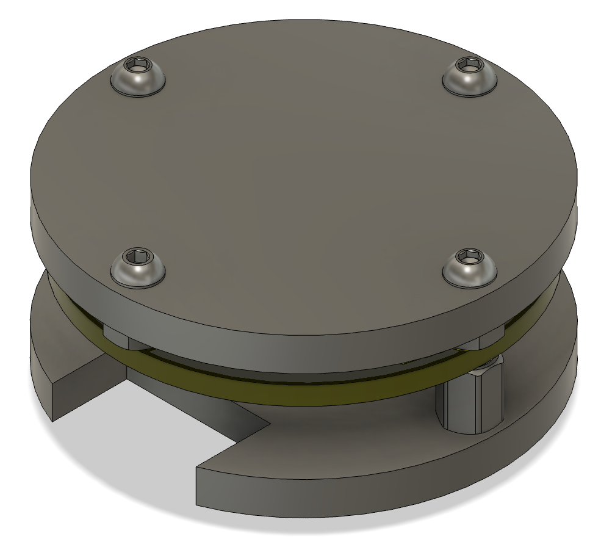

<!-- <video playsinline class="post lazy" data-poster="/assets/MsRNmcq.png" autoplay="autoplay" muted="muted" loop="loop" data-src="/assets/MsRNmcq.mp4"></video> -->

---

**Retired**

Alternatives:

- [Fibonacci64 Micro HDR](/fibonacci64-micro-hdr)
- [Fibonacci64 50mm](/fibonacci64-goggles)
- [One Inch Fibonacci64](/one-inch-fibonacci64)

---

<h2>Table of Contents</h2>

- TOC
{:toc}

## Details

Fibonacci64 Nano is a tiny, beautiful 33mm circular disc with 64 RGB LEDs surface mounted in a Fibonacci distribution. Swirling and pulsing like a miniature galaxy, it's mesmerizing to watch.

It consists of 64 SK6805-EC15 1.5mm RGB LEDs, arranged into a circular <a href="https://en.wikipedia.org/wiki/Fermat%27s_spiral">Fermat's spiral</a> pattern.

It has solder pads on the back that match the pinout of the [QT Py by Adafruit](https://www.adafruit.com/?q=qt+py), or [XIAO by Seeed](https://www.seeedstudio.com/catalogsearch/result/?q=xiao). It can be used by any microcontroller via the 5V, GND, and Data In pins. It also has a Data Out pad, for connecting more LEDs on the same data pin.

Three of the four mounting holes are surrounded by capacitive touch compatible pads. They're connected to the A0-A2 pads/pins on the QT Py footprint. The SAMD21 QT Py supports capacitive touch on these pins.



---

## Specifications

- Size: 1.3 x 1.3 x .063 inch (33 x 33 x 1.6 mm)
- 2 layer printed circuit board
- FR4 substrate
- Black SMOBC (solder mask over bare copper)
- HASL (Hot Air Solder Leveling)
- Designed in the US by Evil Genius Labs
- Assembled in the US by [Cyber City Circuits](https://cybercitycircuits.com)

**Parts**

Options available to purchase for additional amount:

- Diffuser: 3mm black LED acrylic circle.
- Open Case Kit: diffuser, back plate with wall mounting hole, M2 black nylon standoffs, M2 black metal screws.
- Fully Assembled: diffuser, open case, and assembled [QT Py by Adafruit](https://www.adafruit.com/product/4600) controller.

If the "Fully Assembled" option is not chosen, these parts are **not included**, but are required to assemble and use:

- Microcontroller (Arduino, ESP8266, ESP32, etc)
- Wires, connectors, crimp tool, etc.
- Soldering iron, solder, etc.

Parts I used in my builds:

- [QT Py by Adafruit](https://www.adafruit.com/product/4600)(https://electromage.com)
- [Chemcast Black LED Acrylic](https://www.tapplastics.com/product/plastics/cut_to_size_plastic/black_led_sheet/668)

## Code

**Please note the code is in the `f64-nano` branch!**

Open source touch demo: [https://github.com/jasoncoon/fibonacci64-touch-demo/tree/f64-nano](https://github.com/jasoncoon/fibonacci64-touch-demo/tree/f64-nano)

## Pixelblaze Map

[Pixelblaze](https://www.bhencke.com/pixelblaze) is an advanced WiFi LED pattern engine, created by [ElectroMage](https://electromage.com). Live pattern expression compiler, lightning fast fixed point math, and HDR!

Fibonacci boards are laid out physically in a zig-zag pattern, from center to edge and back to center, all the way around the board. This layout automatically makes one dimensional patterns designed for strips visually interesting.

To treat the board as a matrix, you can use a pixel map. A 2D XY map can allow you to scroll colors, palettes, and patterns across the panel horizontally, vertically, diagonally, etc.

This map can be copied and pasted into the Pixel Mapper in the Mapper tab of your Pixelblaze web interface.

  

    <h3 class="accordion-header" id="headingOne"><button class="accordion-button collapsed" type="button" data-toggle="collapse" data-target="#collapseOne" aria-expanded="false" aria-controls="collapseOne">Pixelblaze XY Map (click to expand)</button></h3>
    

      

        <pre>
[[140,128],[189,114],[208,91],[214,63],[208,34],[146,0],[168,21],[180,48],[180,76],[162,106],[152,78],[146,47],[129,25],[103,11],[72,5],[40,38],[70,35],[97,42],[120,61],[131,101],[107,87],[79,69],[50,68],[23,78],[0,98],[7,143],[23,118],[46,102],[76,98],[93,122],[57,131],[37,152],[28,179],[29,209],[87,255],[68,230],[59,202],[62,174],[80,148],[113,142],[91,181],[94,210],[109,235],[133,252],[202,235],[172,234],[145,224],[125,203],[117,170],[145,183],[170,201],[198,205],[227,198],[253,181],[255,134],[235,157],[210,171],[181,173],[148,153],[175,145],[207,138],[228,120],[240,93],[244,63]]
        </pre>
      

    

  

## Assembly Instructions

**Note**: Double-check the position, alignment, and orientation of each component very carefully before soldering!

If you're new to soldering, I highly recommend reading through a good soldering tutorial, such as the ones by [Adafruit](https://learn.adafruit.com/adafruit-guide-excellent-soldering) and [SparkFun](https://learn.sparkfun.com/tutorials/how-to-solder-through-hole-soldering).

1. Find a clean spot on your soldering workspace. I used a piece of heavy card stock. Carefully place the board with the LEDs facing down and the bottom of the board facing up.
1. **VERY** carefully check polarity before connecting 5V and GND.
1. Either:

- Solder wires to the pads on the back of the Fibonacci PCB and connect them to your microcontroller.
- Or:
- Carefully align an Adafruit QT Py, Seeeduino XIAO, or another controller with an identical footprint with the pads on the back of the Fibonacci PCB. Solder the pads.

1. Each SK6805-EC15 can theoretically draw 15mA at full brightness, solid white color. 64 of them can theoretically draw 960mA. I suggest using [FastLED's power management](https://github.com/FastLED/FastLED/wiki/Power-notes#managing-power-in-fastled) to limit the maximum brightness to a reasonable amount, well under the maximum your power supply is rated for. I've found that 960mA is blindingly bright.
1. Keep an eye on the temperature of the PCB and especially the connectors. High temperatures can reduce the life of the LEDs. When possible, ensure air can flow, either passively (ventilation) or actively (exhaust fan).

## Acrylic Open Case Assembly Instructions

1. Peel and remove any protective plastic and/or paper film from the acrylic.
1. Insert M2x6mm Button Head Hex Screw into the bottom hole in the matte side of the acrylic face plate.
1. Insert M2x8mm Button Head Hex Screws into the remaining holes in the matte side of the acrylic face plate.
1. Hand-tighten M2 Hex Metal Nuts onto the screws, on the glossy side of the acrylic face plate.
1. Carefully center and place the Fibonacci PCB onto the standoffs, with the LED side facing the glossy side of the acrylic face plate.
1. Hand-tighten M2 Nylon Hex Standoffs onto the back side of the Fibonacci PCB.
1. Center and place the acrylic back plate on the standoffs.
1. Insert and hand-tighten M2x6mm Button Head Hex Screws through the holes in the matte side of the acrylic back plate and into the standoffs.

