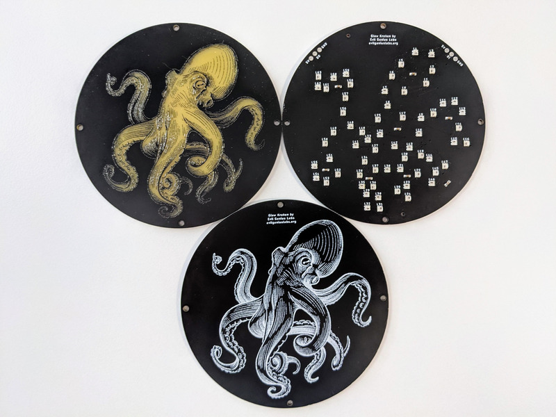
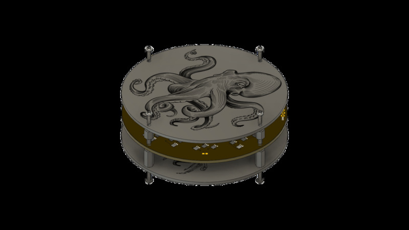
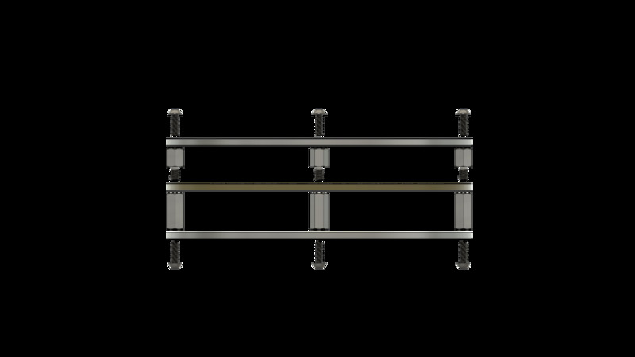
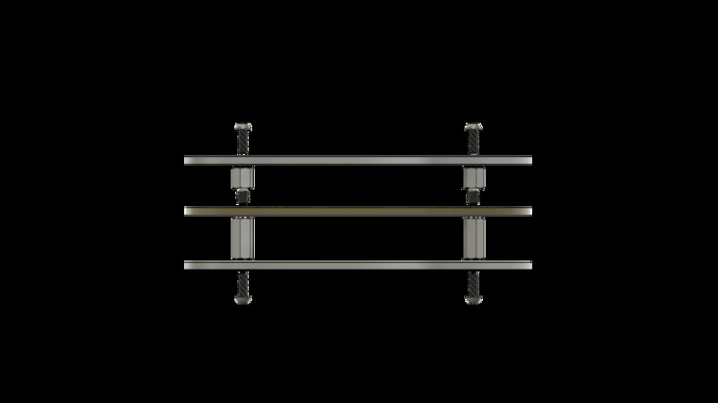
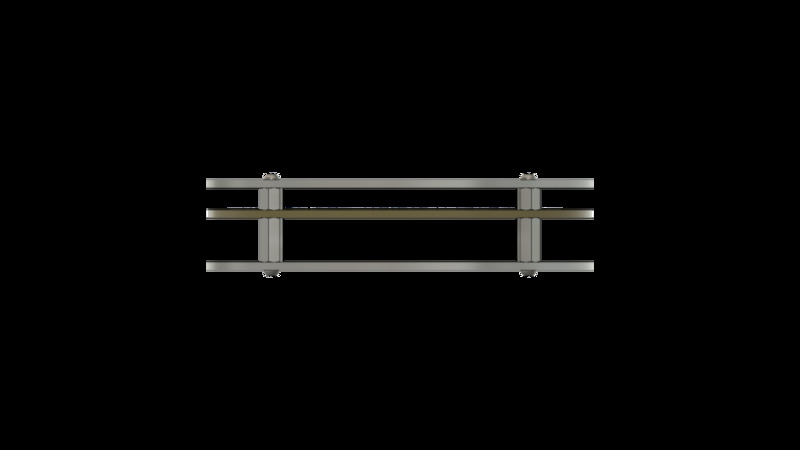
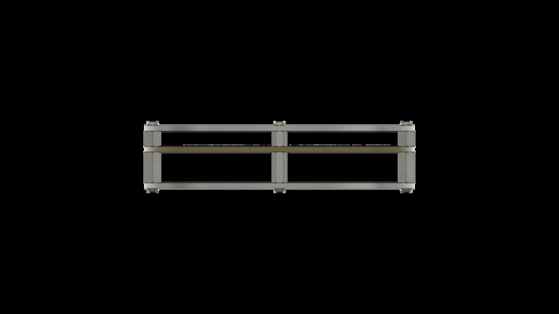
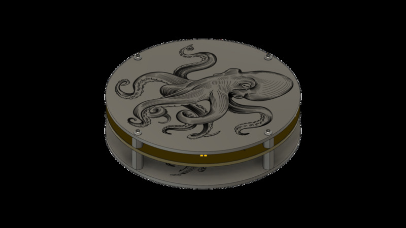

<!-- <video playsinline class="post lazy" data-poster="/assets/Xvb7A1T.png" autoplay="autoplay" muted="muted" loop="loop" data-src="/assets/Xvb7A1T.mp4"></video> -->

<h3>Table of Contents</h3>

- TOC
{:toc}

### Details

Chamaeleon64 can use its color-changing iridophores to blend in, or to mesmerize you.

It consists of three different printed circuit boards (PCBs), stacked up and mounted to each other with M2 standoffs and screws.

The top PCB has the Chamealeon design in exposed FR4 (fiberglass) on both sides that allows the light from the LEDs on the middle PCB to shine through. White silkscreen on matte black (or black silkscreen on white) soldermask provides all of the details of the design on both sides. Holes for M2 bolts/screws are included on all three PCBs.

The middle PCB has 64 WS2812C-2020 2mm square addressable RGB LEDs and eight decoupling capacitors already surface-mounted in the shape of the Chamaeleon design. They're arranged so that the head, body, legs, and tail can each easily be lit completely individually. The top and bottom of the LED PCB are large 5V and GND planes, although the LEDs need only 5mA per color channel each, 960mA total max for solid white, full brightness. Two separate three-pin headers are provided. One for 5V, Data In, and GND, and the other for 5V, Data Out, and GND. The Data Out pin can be used to connect to even more LEDs.

The bottom PCB has the Chamaeleon design in white silkscreen on both sides.

**Options**

Chamaeleon64 can be purchased as a kit with the three PCBs and M2 hardware for you to use your own controller, such as a [Pixelblaze](https://www.bhencke.com/pixelblaze) by [ElectroMage](https://electromage.com), etc.

The Fully Assembled option includes all three PCBs, already assembled with M2 hardware and pre-programmed Adafruit QT Py SAMD21 controller.

**Specifications**

- PCB Size: 3.39 x 3.39 x .063 inch (86 x 86 x 1.6 mm) each
- Three 2 layer printed circuit boards
- FR4 substrate
- White silkscreen with black SMOBC (solder mask over bare copper) or
- Black silkscreen with white SMOBC (solder mask over bare copper)
- Lead-Free HASL (Hot Air Solder Leveling) Finish
- Designed and assembled in the US by Evil Genius Labs

### Code

Open source touch demo: [https://github.com/jasoncoon/chamaeleon64-qt-py](https://github.com/jasoncoon/chamaeleon64-qt-py)

### Assembly Instructions

1. Arrange the three PCBs, making sure the graphics line up with the LEDs.
1. Insert M2x6mm Button Head Hex Screws into the holes in the top PCB (the one with the yellowish exposed FR4).
1. Hand-tighten M2x5+6 Standoffs onto the screws, on the back side of the top PCB.
1. Carefully center and place the LED PCB onto the standoffs, with the LED side facing the top PCB.
1. Hand-tighten M2 Nylon Hex Standoffs onto the back side of the LED PCB.
1. Center and place the bottom PCB onto the standoffs.
1. Hand-tighten M2x6mm Button Head Hex Screws through the bottom PCB, into the standoffs.

