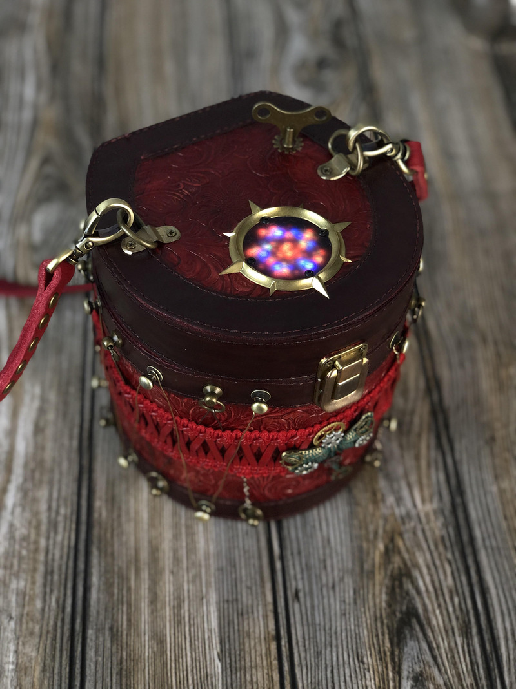

<a target="_blank" href="/assets/S6khzhg.mp4"><video style="width:340px" class="img-fluid post-img lazy" data-src="/assets/S6khzhg.mp4" autoplay muted loop playsinline></video></a>

<!-- <blockquote class="twitter-tweet">
Thank you! I was going to share it with you so I’m glad you saw it! Here is a video. <a href="https://t.co/XCp3enphAK">pic.twitter.com/XCp3enphAK</a>
&mdash; Dithermaster (@Dithermaster) <a href="https://twitter.com/Dithermaster/status/1457574539022512131?ref_src=twsrc%5Etfw">November 8, 2021</a></blockquote>

<blockquote class="twitter-tweet">
Yes! We culled the color palettes to fit the application and added a delay to the pulse sweeps, which we made red. Those and the CNC’ed compass rose make a Martian detector for a “War of the Worlds” themed steampunk convention. 2500 mAh USB battery ran it for 7-8 hours.
&mdash; Dithermaster (@Dithermaster) <a href="https://twitter.com/Dithermaster/status/1457524576779489284?ref_src=twsrc%5Etfw">November 8, 2021</a></blockquote> -->
