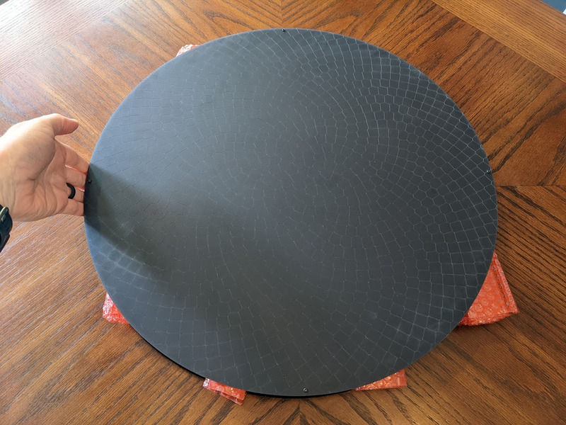
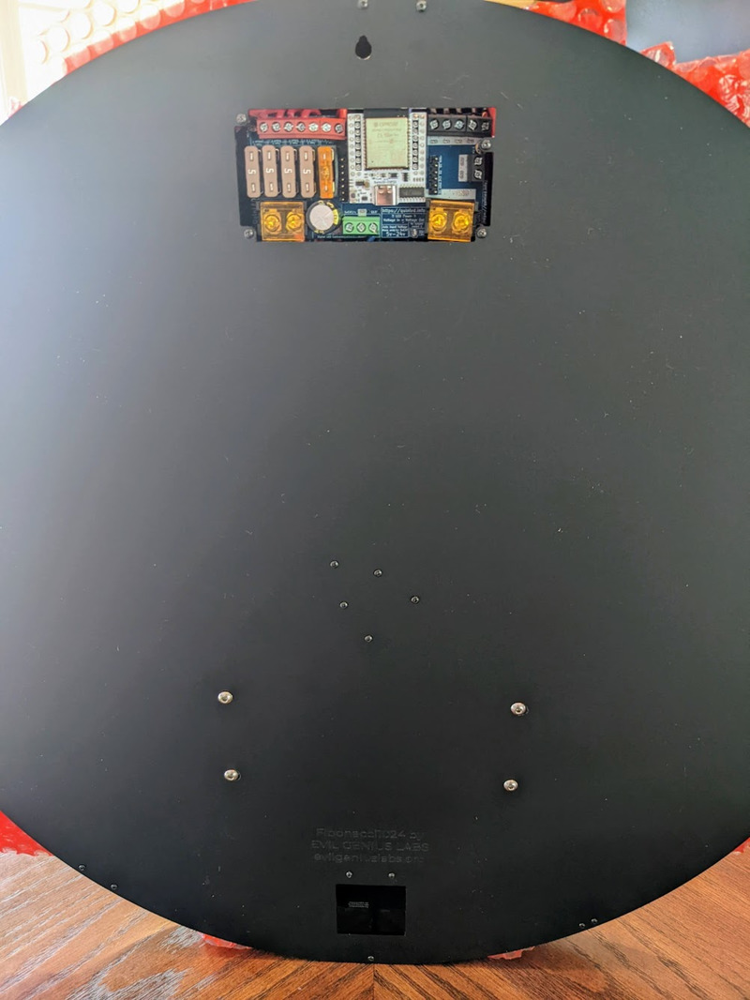
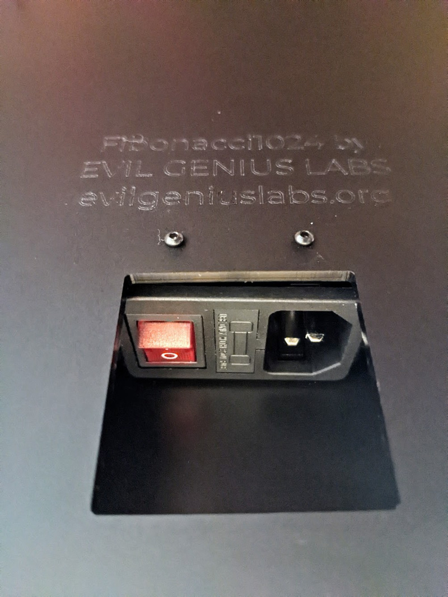
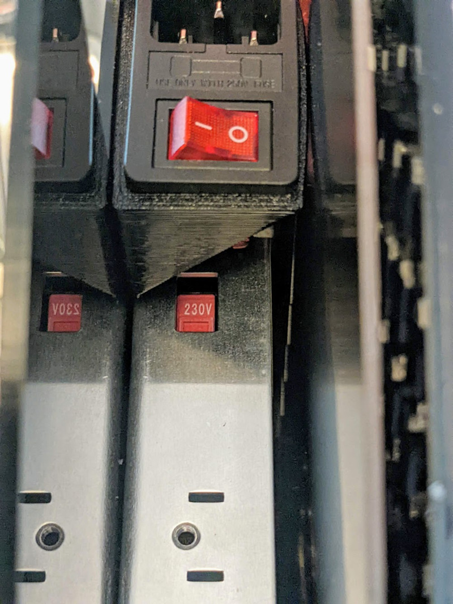
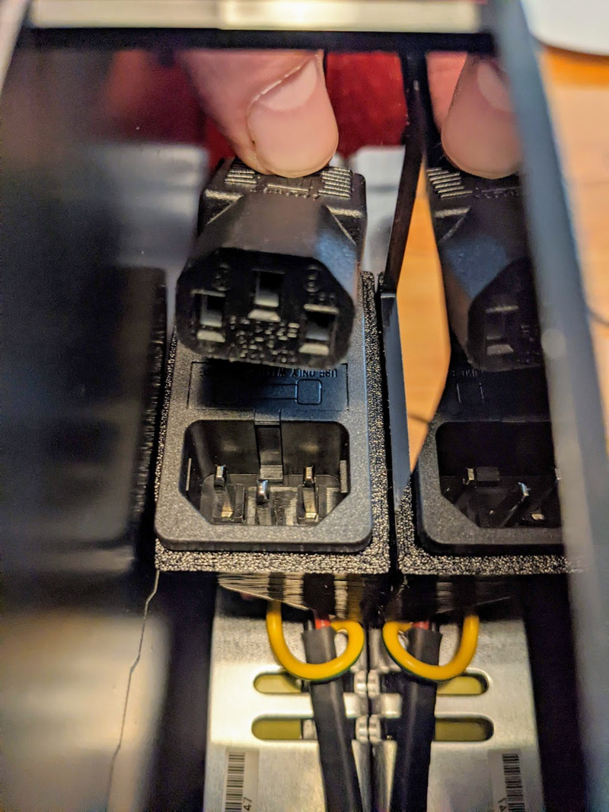
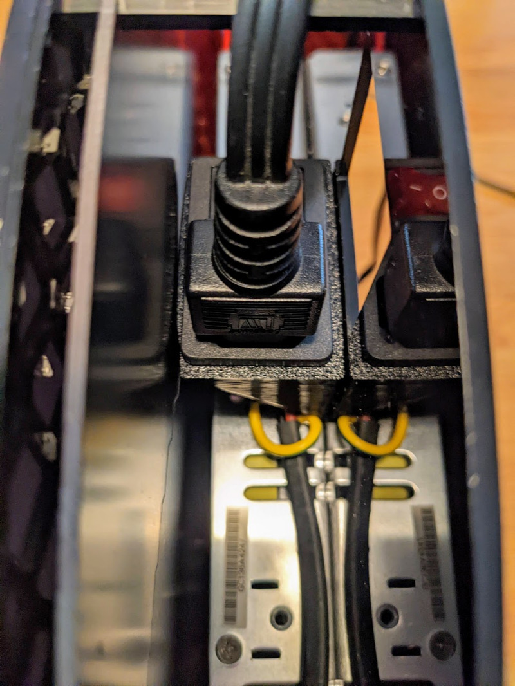
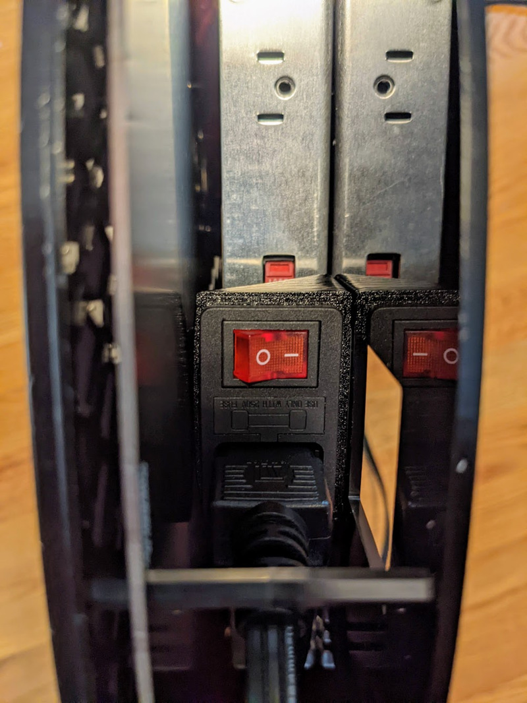
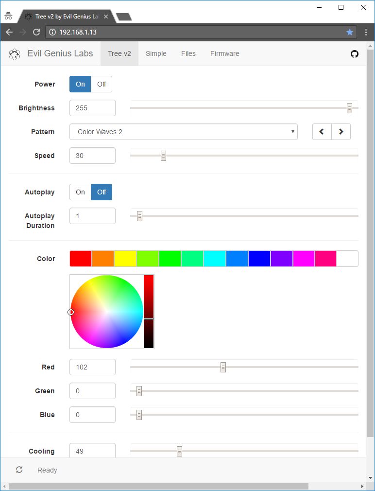

<!-- 

   <video playsinline class="post lazy" autoplay="autoplay" muted="muted" loop="loop" data-src="/assets/QtWv6Z8.mp4"></video>

 -->

<h3>Table of Contents</h3>

- TOC
{:toc}

### Details

Fibonacci1024 is an enormous, beautiful 500mm (19.7") circular disc with 1024 RGB LEDs surface mounted in a Fibonacci distribution. Swirling and pulsing like a colorful galaxy, it's mesmerizing to watch.

It consists of 1024 WS2812B-Mini 3535 RGB LEDs, arranged into a circular <a href="https://en.wikipedia.org/wiki/Fermat%27s_spiral">Fermat's spiral</a> pattern.

I have created several LED art pieces in Fibonacci patterns. They are all very labor intensive to create, and so are fairly expensive and limited in quantity. I wanted to come up with a Fibonacci layout that was at least slightly easier to create, and therefore more affordable.

I have RGB LEDs in just about every form they come: strips, strings, rings, discs, etc. The LEDs on most discs are arranged in very regular rings. Fibonacci1024 is different. The LEDs are arranged in a Fibonacci distribution. The makes the layout very organic and seemingly messy. But with the proper animation, spiral patterns emerge with spectacular results.

Each of the 1024 WS2812B-Mini 3535 RGB LEDs has its own decoupling capacitor built in. The top and bottom of the PCBs are large 5V and GND planes, to allow for the large amount of current required by the 1024 LEDs. The PCB is split into five separate pieces to allow for higher frame rates when driven by a microcontroller that supports the FastLED library's parallel output, such as ESP8266, ESP32, Teensy, etc. The max theoretical frame rate with four way parallel output is ~160 FPS.



---

### Setup Instructions

1. Carefully remove the Fibonacci from the package, holding it by the sides and/or back, near the four support posts. Remove the packing material from inside the Fibonacci. If you need to lay it flat, lay it on the back, not the front.

   

1. **Warning**: Before connecting the AC power cord, look inside of the Fibonacci from the bottom. Ensure the red slide switch on the power supply is set to the correct AC input voltage for your country (115V or 230V). If it is not, use a flat screwdriver to slide it to the correct voltage.

   
   
   

1. **Warning**: If ever connecting to the USB-C connector on the controller on the upper back of the Fibonacci, unplug from AC power first. Not doing so can back feed 5V DC to the USB port on your computer.
1. Insert an IEC C13 AC power cord into the AC input socket at the bottom of your Fibonacci. Ensure it is fully and securely inserted.

   
   

1. Turn the red power switch on, on the lower back of the Fibonacci.

   

Your Fibonacci display should start shortly.

For more control, you can connect your Fibonacci to your WiFi network, and control it via a web page. It only takes a minute to set this up:

1. Once powered on, it will create a WiFi network named `Fibonacci1024`.
1. Connect to this network with a phone, laptop, etc. You should get redirected, or prompted to sign in.
1. In the WiFi Manager page, click `Configure WiFi`.
1. Choose your WiFi network from the list, or enter its SSID manually, if needed. Enter your network's password. Click Save.
1. It will save, restart, and your device (phone, laptop, etc) should reconnect to your WiFi network. Do so manually, if needed.
1. On your device, browse to http://fibonacci1024.local
1. You should now be able to control your Fibonacci via the web page.
1. If this does not work, you may need to consult your WiFI AP/router documentation to find your Fibonacci’s IP address, or contact me for assistance.

### Specifications

- Size: 500 x 500 x 1.6mm (12.6 x 12.6 x .063 inch)
- 2 layer printed circuit board
- FR4 substrate
- Black SMOBC (solder mask over bare copper)
- HASL (Hot Air Solder Leveling)
- Designed and assembled in the US by Evil Genius Labs

### Code

Open source example firmware and web application: [https://github.com/jasoncoon/esp32-fastled-webserver/tree/f1024](https://github.com/jasoncoon/esp32-fastled-webserver/tree/f1024)

