<!-- <video playsinline class="post lazy" data-poster="/assets/XFR7m2E.png" autoplay="autoplay" muted="muted" loop="loop" style="width:684px" data-src="/assets/XFR7m2E.mp4"></video> -->

<h3>Table of Contents</h3>

- TOC
{:toc}

### Details

Fibonacci HDR Heart is a tiny, beautiful 42mm heart-shaped disc with 74 SK9822-EC20 HDR RGB LEDs surface mounted in a Fibonacci distribution. Swirling and pulsing like a miniature galaxy, it's mesmerizing to watch.

It consists of 74 SK9822-EC2020 HDR (High Dymanic Range) RGB LEDs, arranged into a <a href="https://en.wikipedia.org/wiki/Fermat%27s_spiral">Fermat's spiral</a> pattern.

It has solder pads on the back that match the pinout of a [Pixelblaze V3 Pico by ElectroMage](https://shop.electromage.com/products/pixelblaze-v3-pico-tiny-wifi-led-controller). It can be used by any microcontroller via the 5V, GND, Clock and Data In pins.



---

### Specifications

- Size: 1.65 x 1.42 x .063 inch (42.0 x 36.0 x 1.6 mm)
- 2 layer printed circuit board
- FR4 substrate
- Black or Purple SMOBC (solder mask over bare copper)
- HASL (Hot Air Solder Leveling) or ENIG (electroless nickel immersion gold) Finish
- Designed in the US by Evil Genius Labs
- Some PCBs are manufactured in the US by [OSH Park](https://oshpark.com)
- Some are assembled in the US by Evil Genius Labs

### Pixelblaze Map

[Pixelblaze](https://www.bhencke.com/pixelblaze) is an advanced WiFi LED pattern engine, created by [ElectroMage](https://electromage.com). Live pattern expression compiler, lightning fast fixed point math, and HDR!

Fibonacci boards are laid out physically in a zig-zag pattern, from center to edge and back to center, all the way around the board. This layout automatically makes one dimensional patterns designed for strips visually interesting.

To treat the board as a matrix, you can use a pixel map. A 2D XY map can allow you to scroll colors, palettes, and patterns across the panel horizontally, vertically, diagonally, etc.

This map can be copied and pasted into the Pixel Mapper in the Mapper tab of your Pixelblaze web interface.

View in [LED Mapper](https://jasoncoon.github.io/led-mapper/?p=NrBMoOgFgZgGlDCA2AunMAOCiEFYIBGATnWBgAZpQEB2CYvMmQiC4uFnNDUewmjCSFCZPkTwJiEWqDFQGHUMiJQxSWrSkQ8c3q1CYEK2pjKEqeZJwV7g-QZGR2FFI6GnFa5mTWUQYUl4ZLRIZMwwkTCgEDW8MAkxJcXYybDx3aSgg4BFwzipaNQxCAkJrShRREuwoa0MdcwVouiJ43NYWYxQc9OSFWiYMFWRk1kxq4AJBuEJsOwJiGMJbGDFChCrzFWy4BVhzJDc4fgpzKlHZqhh26SFZpEYyaTnZ+jw1kqpQGNBCnlykAysRwQ1yJiUChgYNK3AQBk+uWE1jmqnMkCSswGOUIj0Is1Y2W2RHg6XaYS6Kg86hwMWaETAL3g73aoDK+PoyByoFYeBi2Ew5OwtHxFgYDPKDBouIgSWJeA4hHoMDsYVePIYiLCyFC2GQxTAlkVA0m4AYkgEOAZ-lxBLYpukRSuDEmQmgKNYXjIUCoFHqtmY2HufwCAOhMkVysRKpQRlhLDE0g8WPdYkWKIUT14Rwt9DcNPgIeQpvoylmQejF0V6VdSB1CCouOY9Qx0foUGSKmhzHomA4lRgDJgCn1nE60ds7k5ORj7gUGWY3xbATB-l08J0pFQQA)

  

    <h4 class="accordion-header" id="headingOne"><button class="accordion-button collapsed" type="button" data-toggle="collapse" data-target="#collapseOne" aria-expanded="false" aria-controls="collapseOne">Pixelblaze XY Map (click to expand)</button></h4>
    

      

        <pre>
[[22.43,23.6],[28.23,25.19],[30.42,27.95],[31.09,31.26],[27.12,33.11],[27.15,29.72],[24.99,26.14],[23.77,29.52],[21.28,26.78],[10.56,34.2],[7.12,32.62],[4.08,29.97],[1.72,26.39],[2.77,19.78],[3.84,23.77],[5.85,27.09],[8.58,29.49],[11.78,30.74],[15.16,30.61],[18.46,28.5],[14.84,27.17],[11.31,26.69],[8.55,24.75],[6.65,21.81],[5.75,18.2],[5.94,14.23],[20.7,2.61],[16.49,4.43],[13.08,7.10],[10.65,10.37],[9.33,13.95],[9.18,17.53],[10.24,20.76],[12.58,23.25],[16.79,24.35],[15.26,21.23],[13.16,18.14],[12.85,14.79],[13.91,11.49],[16.13,8.57],[19.31,6.29],[23.24,4.88],[29.13,7.57],[25.11,7.69],[21.54,8.87],[18.71,10.98],[16.92,13.85],[16.59,17.32],[19.18,21.93],[19.67,18.64],[20.59,14.71],[22.95,12.28],[26.13,11.01],[29.74,10.91],[33.46,11.97],[40.06,24.2],[38.33,20.36],[35.79,17.33],[32.68,15.31],[29.29,14.46],[25.96,14.95],[23.05,17.08],[23.3,20.61],[27.26,18.33],[30.69,18.51],[33.67,20.13],[36,22.83],[37.45,26.35],[37.89,30.38],[34.64,31.33],[34.28,27.69],[32.8,24.58],[30.26,22.35],[26.52,21.59]]
        </pre>
      

    

  

### Instructions

All instructions are identical to the rounnd [Lux Lavalier](https://luxlavalier.com/start), other than:

- The shape of the pendant.
- The Pixelblaze Pico sits horizontally on the heart rather than vertically on the circle.
- In the Pixelblaze settings, set Pixels to 74 for the Heart, rather than 64 for the circle.
- In the Pixelblaze Mapper, use the map [above](#pixelblaze-map).

[https://luxlavalier.com/start](https://luxlavalier.com/start)

### Assembly Instructions

### PCB Assembly Instructions

##### Soldering Notes:

If you're new to soldering, we highly recommend reading through a good soldering tutorial,
such as the ones by [Adafruit](https://learn.adafruit.com/adafruit-guide-excellent-soldering)
and [SparkFun](https://learn.sparkfun.com/tutorials/how-to-solder-through-hole-soldering).

We recommend using only lead-free solder and a good quality, temperature-controlled soldering iron set to 750F/400C.

When soldering, clean the soldering tip often. We recommend using a brass wire sponge. After cleaning, melt a small amount of solder onto the tip of the iron.

Using the high 750F/400C temperature should mean that you don't need to heat the pads for more than a few seconds at at time. This allows you to work more quickly and avoid overheating and damaging the pads or any components.

If you're having a hard time getting the solder to melt, check your temperature.

If the solder is sticking to the iron but not the pads, you may not be heating the pads long enough, but it should only take a few seconds. You can use soldering flux, which may help.

---

##### Soldering the Pixelblaze Pico onto the back of the Fibonacci HDR Heart board:

1. Note where and how the Pixelblaze Pico aligns with the outline on the back of the Fibonacci board,
   and how the contacts line up.

   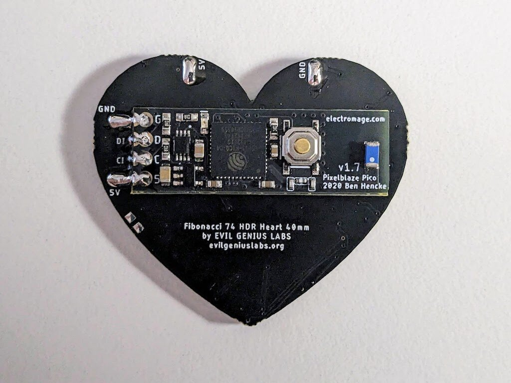

1. Tin the 5V pad by melting a blob of solder onto it.

1. Carefully align the Pico with the outline and contacts on the back of the Fibonacci board,
   and reheat the solder blob on the 5V pad, while holding both boards in place.
   Remove the soldering iron, wait for the solder blob to cool.

   Check the alignment. If it's not centered, reheat the solder blob, re-align it,
   and repeat as necessary until it's aligned correctly.

   Ensure the end of the Pico does not extend past the edge of the Fibonacci board!

1. Once again, check the alignment. <b>Do not proceed</b> until it's aligned correctly.
   See the step above if it's not.

   Solder the GND pad. Make sure you get a nice smooth fillet of solder on the pads.
   Use plenty of solder on the pad, then inside the pin header hole.

1. Repeat for the Data, CLK, and 5V pads, making sure to use plenty of solder.
   Ensure there are no bridged connections between the pads.

1. Clean up any flux on the PCBs and contacts with isopropyl alcohol,
   especially if you didn't use solder with no-clean flux.

### Necklace Assembly Instructions

##### Trimming and soldering the magnetic wearable battery connector necklace:

1. Unwind, unwrap, and gently straighten the wires by holding the wire at the battery holder.
   Gently grip the wire with your other hand and run it down the length of the wire.
   Repeat until the wires are fairly straight. They do not need to be perfectly straight,
   and may still have a curve to them.

   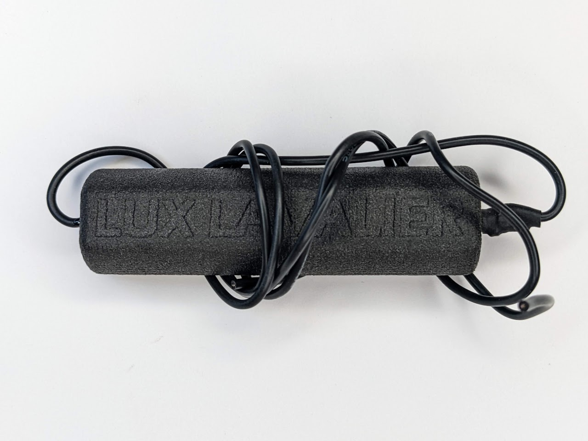

1. Your Lux Lavalier necklace wires will come approximately between 24" and 26".
   The wires will need to be trimmed to the length you desire.

   Determine your desired length by holding the pendant where you'd like it to hang.
   Then wrap the wires around to the back of your neck where the battery holder will rest
   on the nape (base) of your neck, with one wire in each hand. Ensure the pendant still
   rests where desired, pinch the wires on the back of your neck, then lay it out on a flat
   surface.

   Measure the distance between your hands. That's the total length we'll trim the
   wires to, including the width of the battery holder.

   Common necklace lengths are in two inch increments from 14" or 16" (for a "choker" necklace),
   18" for a "princess", 20" to 24" for a "matinee", etc.

1. I'll be trimming this one to 18" total length, so I laid it out with 9" in the center of the battery holder.
   Straighten and lay out the wires. Leave a little extra on both ends of the wires, as you can always trim it
   shorter. Measure twice, cut once.
   Cut the ends of the wires.

   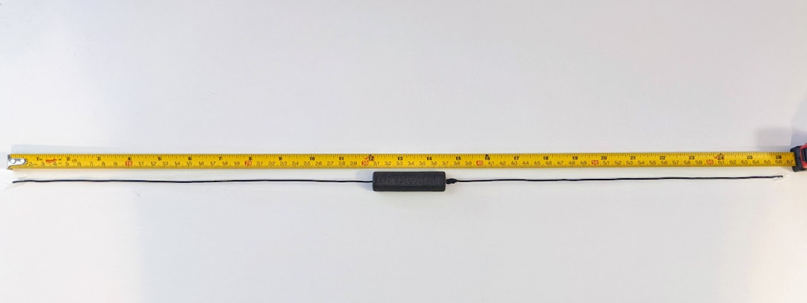

1. Strip about 1/8" (3mm) of insulation off both ends of the wires. The insulation is relatively
   soft silicone, and can usually be stripped off by pinching it between your fingernails.
   If you use wire cutters or strippers, be careful not to cut any of the metal wire strands inside.

   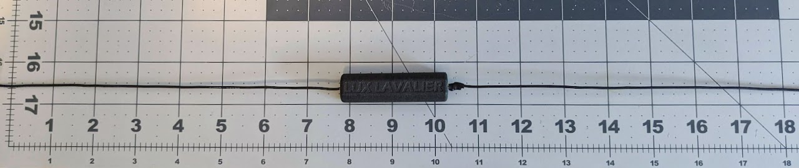

1. Using a soldering iron and solder, tin the ends of both wires, melting and completely saturating
   and covering the ends.

1. Place the wire on the GND pad, with the end of the wire pointing down, towards the edge of the
   round PCB. Hold the wire in place. Tweezers can help to prevent burning your fingers.

   Gently press the soldering iron down onto the wire, reheating the solder, until it
   melts and joins with the solder blob on the GND pad on the PCB. Hold it in place,
   remove the soldering iron, and wait until the solder cools and hardens before releasing.

   Repeat as necessary until the wire and pad are completely covered with a nice compact solder joint.

   Ensure the GND and DATA pads are not bridged or connected with solder.

   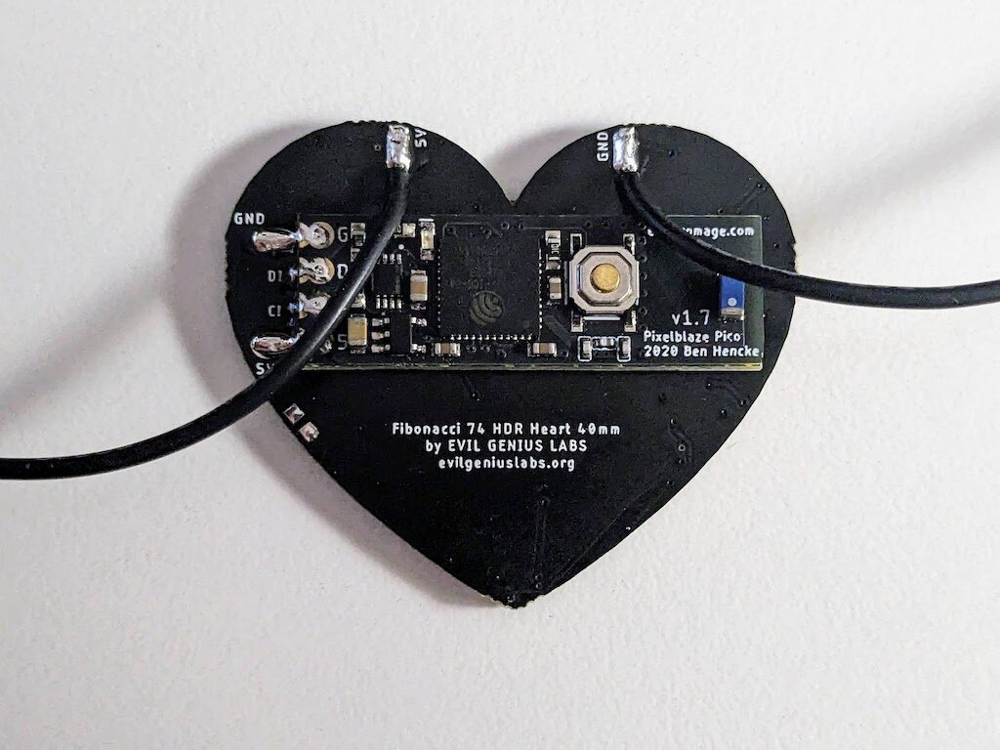

1. Repeat for the other end of the wire and the 5V pad.

1. Before proceeding, once again check to make sure there are no bridged solder joints between any of the pads.
   If you have a multimeter, you can use it to make sure there is no conductivity (or infinite resistance)
   between the pads.

1. Before assembling the case, insert a 14500 3.7V rechargeable lithium battery (not alkaline AA!) with the
   negative end against the spring in the battery holder. The light on the Pixelblaze Pico on the back should
   blink, and then the LEDs on the front should light up.

   Remove the battery before proceeding to assemble the case.

### Case Assembly Instructions

1. The front black acrylic may still have protective film on one or both sides.

1. Gently remove any protective film before proceeding by scraping the edge with a
   fingernail, thin plastic card, or plastic scraper. Do not use a metal object,
   which could scratch the acrylic.

1. Place the pendant on a flat surface with the back of the PCB facing up.
   Carefully and gently bend the wires to point towards the outside edge of the PCB.

1. Place the back plastic cover on the back of the PCB, lining up the the holes,
   with the button tab towards the bottom and the wire holes towards the top.

   Do not press it down flat yet.

   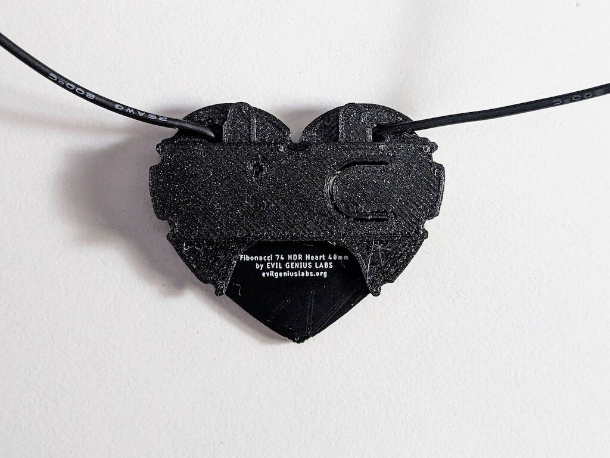

1. Gently guide the wires through the slots, then up through the holes.
   Gently press the back cover down until it's flat against the back of the PCB.

   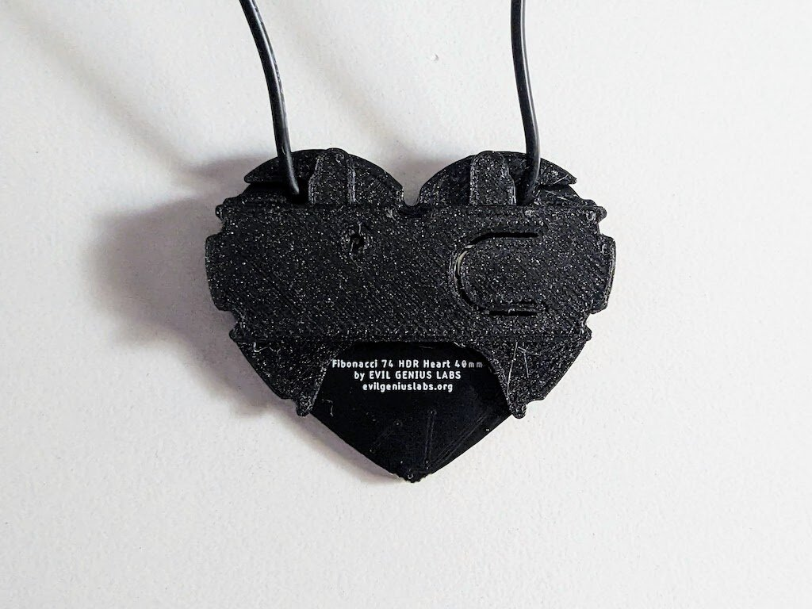

1. Align the holes in the acrylic and PCB, with the matte frosted side facing up and
   the glossy side facing towards the PCB.

1. Insert the M2 x 6mm black metal screws through the holes in the back plastic cover,
   through the PCB, aligning them with the holes in the acrylic. Do not press the screws
   in to the acrylic. The holes in the acrylic are just large enough for the screws to
   thread into.

   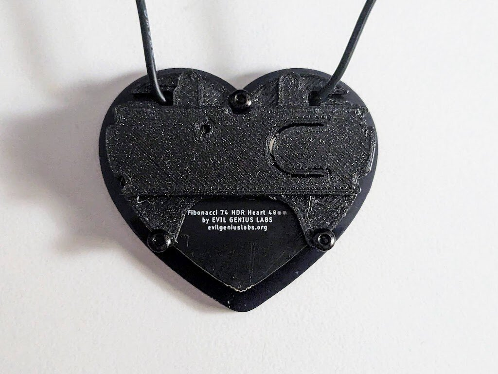

1. Gently thread and hand-tighten the M2 screws, making sure not to pinch the wires.
   Do not over-tighten the screws, or the threads in the acrylic holes might strip.

   The screws should not go all the way through the acrylic. There should be about 1mm
   of space between the end of the screw and the front of the acrylic.

   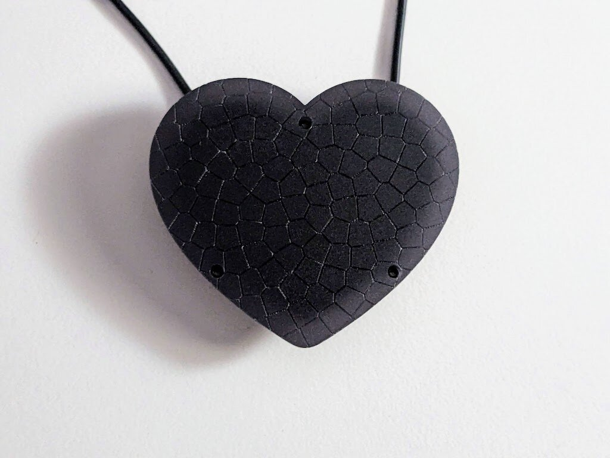

1. Repeat for each of the three screws.

1. Align the bezel with the acrylic and place the clip on one side of the bezel over the side of the acrylic.

1. Press a finger into the gap between the other side of the bezel and the acyrylic.

1. Press the other clip, flexing it over the acrylic. It can take a fair amount of pressure, but the bezel should flex just enough to fit over the acrylic.

   If needed, one of the bezel side clips can be trimmed with a knife or sanded with sandpaper to more easily fit over the acrylic.

   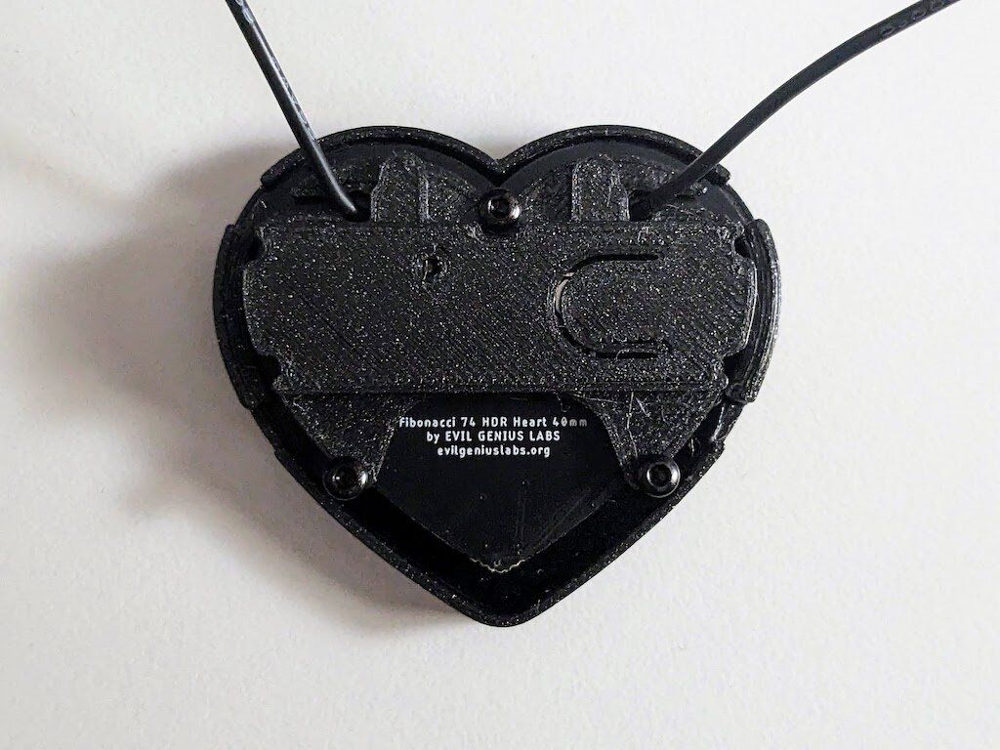

   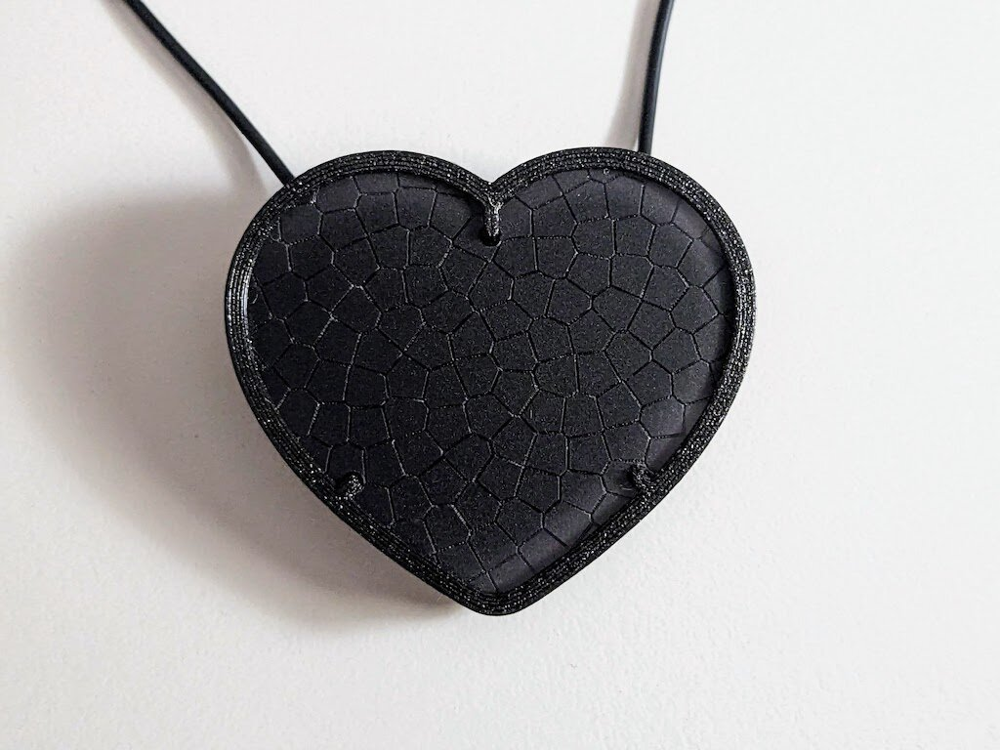

Congratulations! Your Lux Lavalier Heart is now fully assembled!

   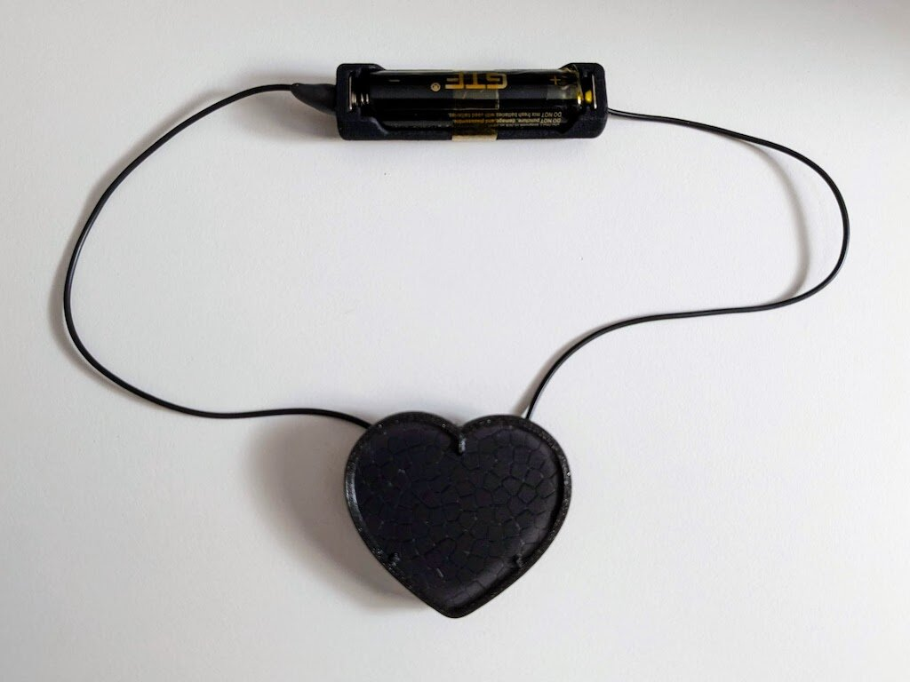
