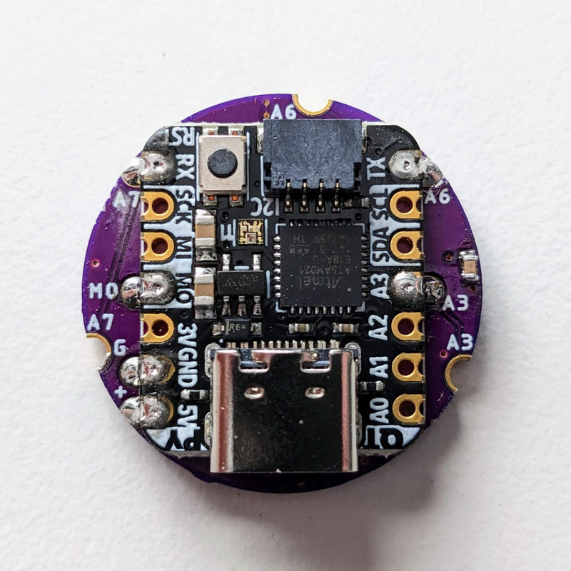
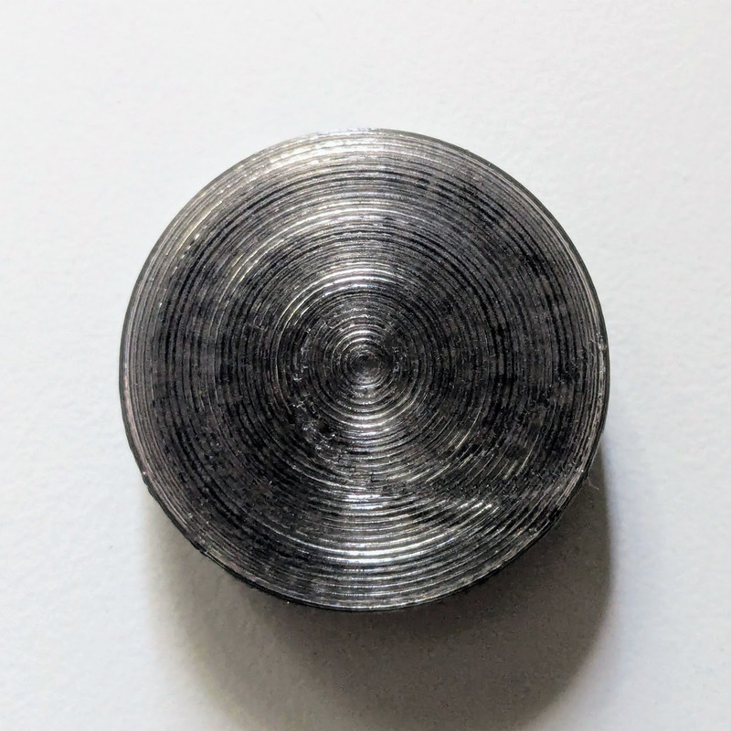
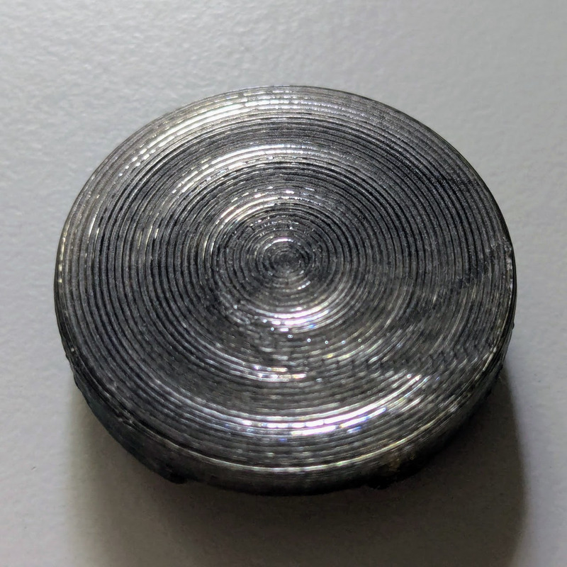
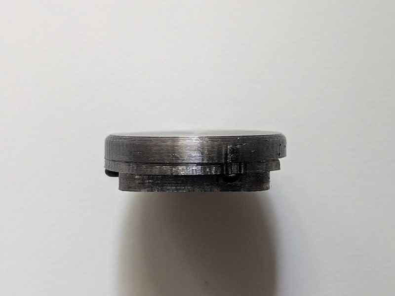
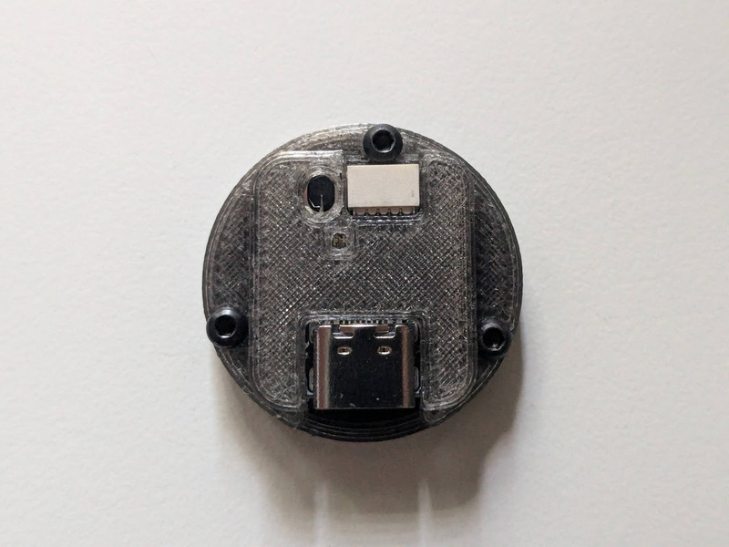
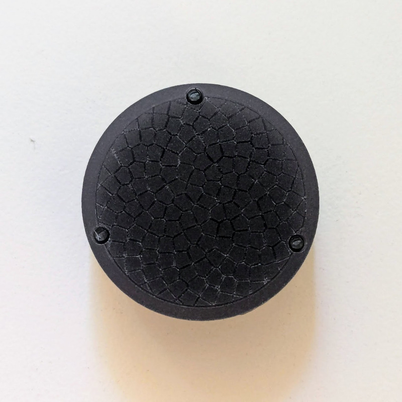
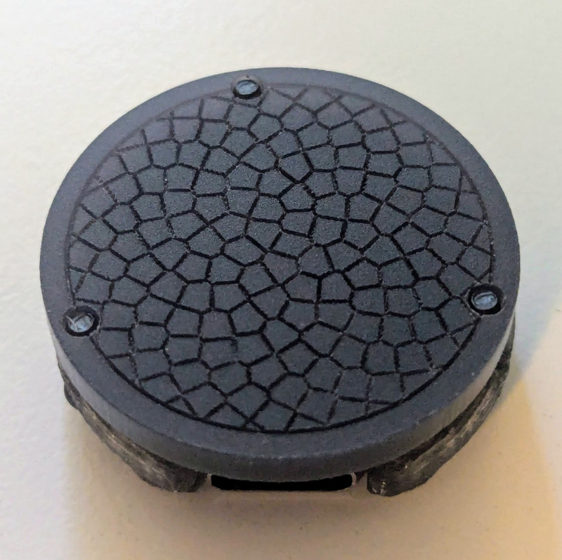
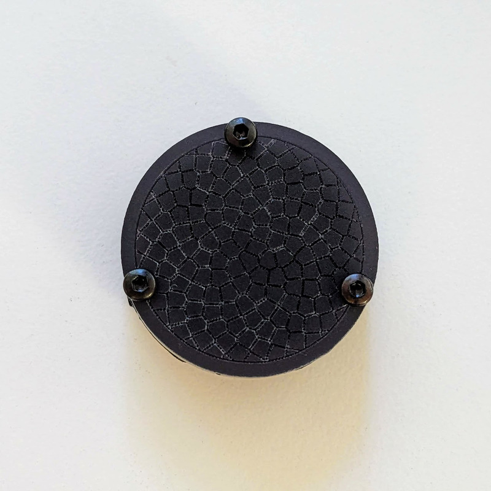
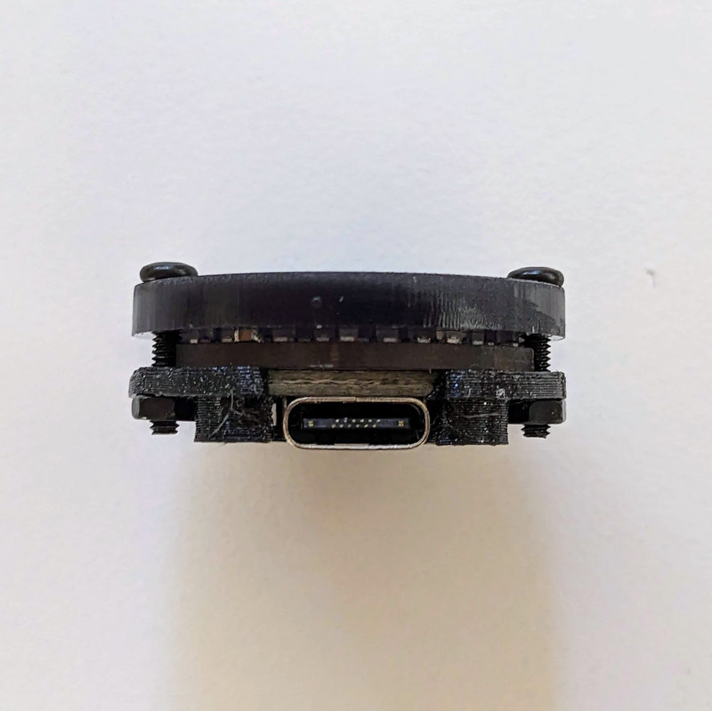

<h3>Table of Contents</h3>

- TOC
{:toc}

### Details

One Inch Fibonacci 128 is a tiny, beautiful 25.4mm circular disc with 128 RGB LEDs surface mounted in a Fibonacci distribution. Swirling and pulsing like a miniature galaxy, it's mesmerizing to watch.

It consists of 128 XL-1010RGBC-WS2812B 1mm² RGB LEDs, arranged into a circular <a href="https://en.wikipedia.org/wiki/Fermat%27s_spiral">Fermat's spiral</a> pattern.

It has solder pads on the back that match the pinout of the [QT Py by Adafruit](https://www.adafruit.com/?q=qt+py), or [XIAO by Seeed](https://www.seeedstudio.com/catalogsearch/result/?q=xiao). It can be used by any microcontroller via the 5V, GND, and Data In pins. It also has a Data Out pad, for connecting more LEDs on the same data pin.

The three mounting holes are surrounded by capacitive touch compatible pads. They're connected to the A0-A2 pads/pins on the QT Py footprint. The SAMD21 QT Py supports capacitive touch on these pins.



---

### Instructions

If you bought the full-assembled version, just plug your new Fibonacci into a power source using a USB-C cable and it will light up.

Touch any of the mounting screws and a wave of light should emanate from that point. Touch multiple and where they overlap the colors will combine, saturating towards white.

Press the button on the back (until it clicks) and it'll switch to the next pattern.  If you disconnect and then reconnect the power, it will also change to the next pattern.

### Specifications

- Size: 1.0 x 1.0 x .063 inch (25.4 x 25.4 x 1.6 mm)
- 2 layer printed circuit board
- FR4 substrate
- Black or Purple SMOBC (solder mask over bare copper)
- HASL (Hot Air Solder Leveling) or ENIG (electroless nickel immersion gold) Finish
- Designed in the US by Evil Genius Labs
- Some PCBs are manufactured in the US by [OSH Park](https://oshpark.com)
- Some are assembled in the US by Evil Genius Labs

### Assembly Instructions

**Note**: Double-check the position, alignment, and orientation of each component very carefully before soldering!

If you're new to soldering, I highly recommend reading through a good soldering tutorial, such as the ones by [Adafruit](https://learn.adafruit.com/adafruit-guide-excellent-soldering) and [SparkFun](https://learn.sparkfun.com/tutorials/how-to-solder-through-hole-soldering).

1. Find a clean spot on your soldering workspace. I used a piece of heavy card stock. Carefully place the board with the LEDs facing down and the bottom of the board facing up.
1. **VERY** carefully check polarity before connecting 5V and GND.
1. Either:

- Solder wires to the pads on the back of the Fibonacci PCB and connect them to your microcontroller.
- Or:
- Carefully align an Adafruit QT Py, Seeeduino XIAO, or another controller with an identical footprint with the pads on the back of the Fibonacci PCB. Solder the pads.

1. Each XL-1010RGBC-WS2812B can theoretically draw 15mA at full brightness, solid white color. 128 of them can theoretically draw 1.92A. I've found tha is blindingly bright, and brightness should be drastically reduced to keep current draw and heat down.
1. Keep an eye on the temperature of the PCB and especially the connectors. High temperatures can reduce the life of the LEDs. When possible, ensure air can flow, either passively (ventilation) or actively (exhaust fan).
1. If using FastLED, I suggest using its [power management](https://github.com/FastLED/FastLED/wiki/Power-notes#managing-power-in-fastled) to limit the maximum brightness to a reasonable amount, well under the maximum your power supply is rated for.

### Case Assembly Instructions

#### 3D printed front

3D print files: [https://www.printables.com/model/831490-1-fibonacci128-screw-diffuser-cover](https://www.printables.com/model/831490-1-fibonacci128-screw-diffuser-cover)

Use M2x4mm screws, inserted from the back, threaded through the back cover, through the LED PCB, and into the front. This option will only let you use the touch points from the back.

#### Acrylic with screws in back

This option requires acrylic with smaller 2.8mm screw holes so the screws thread into the acrylic.

You can use M2x7mm or M2x8mm screws, depending on how far out you want the ends of the screws to protrude from the front. Longer screws let you activate the touch points from the front or rear. Shorter ones will only let you use the touch points from the rear.

#### Acrylic with screws in front

1. Peel and remove any protective plastic and/or paper film from the acrylic.
1. Insert M2x10mm Button Head Hex Screws into the holes in the matte side of the acrylic face plate.
1. Carefully center and place the Fibonacci PCB onto the screws, with the LED side facing the glossy side of the acrylic face plate.
1. Center and place the back plate onto the screws. The back plate should fit flush against the back of the PCB.
1. Hand-tighten M2 Hex Nuts onto the screws.

### Code

Open source touch demo: [https://github.com/jasoncoon/fibonacci128-touch-demo/tree/f128-one-inch](https://github.com/jasoncoon/fibonacci128-touch-demo/tree/f128-one-inch)

#### Pixelblaze Map

  

    <h4 class="accordion-header" id="headingOne"><button class="accordion-button collapsed" type="button" data-toggle="collapse" data-target="#collapseOne" aria-expanded="false" aria-controls="collapseOne">Pixelblaze Map (click to expand)</button></h4>
    

      

        <pre>
[[137,125],[181,118],[201,105],[213,89],[219,71],[221,51],[218,31],[193,20],[198,39],[199,58],[195,77],[184,96],[160,114],[164,95],[176,73],[178,52],[175,33],[167,15],[154,0],[127,4],[142,18],[152,34],[158,53],[157,75],[142,108],[140,88],[140,60],[132,40],[119,26],[103,15],[85,8],[45,28],[65,27],[84,30],[101,39],[116,53],[126,74],[121,97],[106,69],[89,56],[70,49],[51,48],[32,52],[9,89],[25,78],[43,71],[63,70],[83,74],[104,89],[118,116],[84,94],[62,90],[42,94],[25,103],[11,116],[0,133],[11,159],[19,141],[32,126],[47,115],[68,109],[96,112],[81,123],[58,132],[43,145],[33,162],[27,181],[26,200],[49,216],[47,196],[50,177],[58,159],[74,143],[105,129],[94,146],[77,166],[70,186],[69,206],[74,225],[83,242],[125,255],[110,242],[99,227],[91,209],[90,188],[96,165],[114,153],[108,183],[112,205],[121,222],[135,236],[152,246],[193,234],[174,231],[156,224],[141,212],[129,195],[123,170],[130,143],[141,180],[155,198],[172,208],[191,213],[210,213],[239,181],[221,189],[202,192],[182,189],[164,180],[145,159],[164,160],[186,169],[206,170],[225,164],[241,154],[255,140],[248,113],[237,129],[222,141],[204,149],[182,150],[151,140],[170,134],[196,131],[214,121],[227,107],[236,89],[241,70]]
        </pre>
      

    

  

