<h3>Table of Contents</h3>

- TOC
{:toc}

### Details

Fibonacci64 Micro HDR is a beautiful 40mm circular disc with 64 RGB LEDs surface mounted in a Fibonacci distribution. Swirling and pulsing like a miniature galaxy, it's mesmerizing to watch.

It consists of 64 WS2816C-2020 HDR (High Dymanic Range) RGB LEDs, arranged into a circular <a href="https://en.wikipedia.org/wiki/Fermat%27s_spiral">Fermat's spiral</a> pattern.

It has solder pads on the back that match the pinout of a [Pixelblaze V3 Pico by ElectroMage](https://shop.electromage.com/products/pixelblaze-v3-pico-tiny-wifi-led-controller), [QT Py by Adafruit](https://www.adafruit.com/?q=qt+py), or [XIAO by Seeed](https://www.seeedstudio.com/catalogsearch/result/?q=xiao). It can be used by any microcontroller via the 5V, GND, Clock and Data In pins.



---

### Specifications

- Size: 1.57 x 1.57 x .063 inch (40 x 40 x 1.6 mm)
- 2 layer printed circuit board
- FR4 substrate
- Black or Purple SMOBC (solder mask over bare copper)
- HASL (Hot Air Solder Leveling) or ENIG (electroless nickel immersion gold) Finish
- Designed in the US by Evil Genius Labs

**Parts**

Options available to purchase for additional amount:

- Diffuser: 3mm black LED acrylic 42mm circle.
- Open Case Kit: diffuser, back plate with wall mounting hole, M2 black nylon standoffs, M2 black metal screws.
- Fully Assembled: diffuser, open case, and assembled [Pixelblaze V3 Pico by ElectroMage](https://shop.electromage.com/products/pixelblaze-v3-pico-tiny-wifi-led-controller) controller.

If the "Fully Assembled" option is not chosen, these parts are **not included**, but are required to assemble and use:

- Microcontroller (Pixelblaze, Arduino, ESP8266, ESP32, etc)
- Wires, connectors, crimp tool, etc.
- Soldering iron, solder, etc.

Parts I used in my builds:

- [Pixelblaze V3 Pico by ElectroMage](https://shop.electromage.com/products/pixelblaze-v3-pico-tiny-wifi-led-controller)
- [Chemcast Black LED Acrylic](https://www.tapplastics.com/product/plastics/cut_to_size_plastic/black_led_sheet/668)

### Code

Open source touch demo: [https://github.com/jasoncoon/fibonacci64-touch-demo/tree/f64-micro-hdr](https://github.com/jasoncoon/fibonacci64-touch-demo/tree/f64-micro-hdr)

### Pixelblaze Map

[Pixelblaze](https://www.bhencke.com/pixelblaze) is an advanced WiFi LED pattern engine, created by [ElectroMage](https://electromage.com). Live pattern expression compiler, lightning fast fixed point math, and HDR!

Fibonacci boards are laid out physically in a zig-zag pattern, from center to edge and back to center, all the way around the board. This layout automatically makes one dimensional patterns designed for strips visually interesting.

To treat the board as a matrix, you can use a pixel map. A 2D XY map can allow you to scroll colors, palettes, and patterns across the panel horizontally, vertically, diagonally, etc.

This map can be copied and pasted into the Pixel Mapper in the Mapper tab of your Pixelblaze web interface.

  

    <h4 class="accordion-header" id="headingOne"><button class="accordion-button collapsed" type="button" data-toggle="collapse" data-target="#collapseOne" aria-expanded="false" aria-controls="collapseOne">Pixelblaze XY Map (click to expand)</button></h4>
    

      

        <pre>
[[21.5,20],[27.63,18.32],[29.93,15.41],[30.64,11.92],[29.98,8.27],[22.23,4.04],[24.93,6.71],[26.45,9.97],[26.48,13.55],[24.2,17.32],[22.92,13.76],[22.26,9.95],[20.06,7.16],[16.86,5.38],[13.03,4.71],[8.99,8.82],[12.71,8.41],[16.16,9.32],[18.92,11.7],[20.29,16.65],[17.32,14.83],[13.84,12.61],[10.28,12.47],[6.91,13.79],[4.03,16.32],[4.87,21.88],[6.87,18.78],[9.78,16.74],[13.5,16.23],[15.56,19.21],[11.12,20.36],[8.65,22.99],[7.53,26.4],[7.69,30.17],[14.86,35.85],[12.52,32.77],[11.4,29.29],[11.73,25.75],[13.95,22.5],[18.08,21.76],[15.35,26.62],[15.7,30.28],[17.58,33.30],[20.57,35.53],[29.22,33.38],[25.4,33.27],[22.05,31.94],[19.57,29.37],[18.59,25.23],[22.16,26.87],[25.23,29.12],[28.74,29.64],[32.31,28.74],[35.59,26.61],[35.81,20.81],[33.36,23.66],[30.22,25.37],[26.6,25.56],[22.42,23.15],[25.82,22.12],[29.77,21.31],[32.44,18.97],[34,15.68],[34.38,11.85]]
        </pre>
      

    

  

### Case Assembly Instructions

1. Peel and remove any protective plastic and/or paper film from the acrylic.
1. Insert M2x10mm Button Head Hex Screws into the holes in the matte side of the acrylic face plate.
1. Carefully center and place the Fibonacci PCB onto the screws, with the LED side facing the glossy side of the acrylic face plate.
1. Guide the wires through the holes in the back plate. Center and place the back plate onto the screws. Gently pull the slack out of the wires, through the slots in the back plate. The back plate should fit flush against the back of the PCB.
1. Hand-tighten M2 Hex Nuts onto the screws.

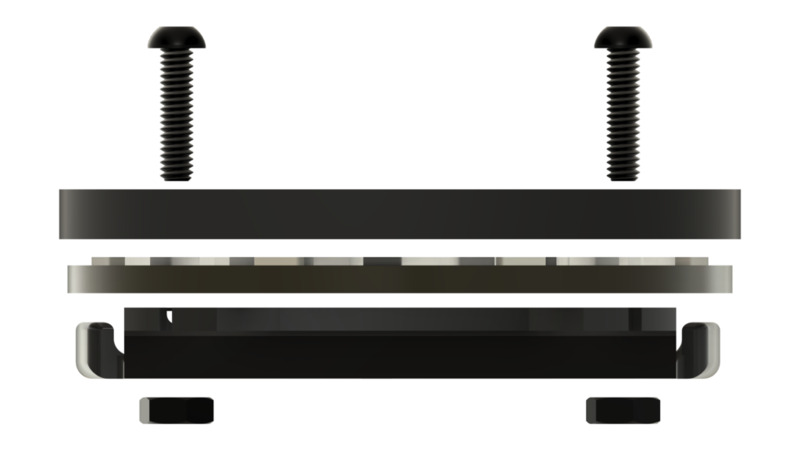

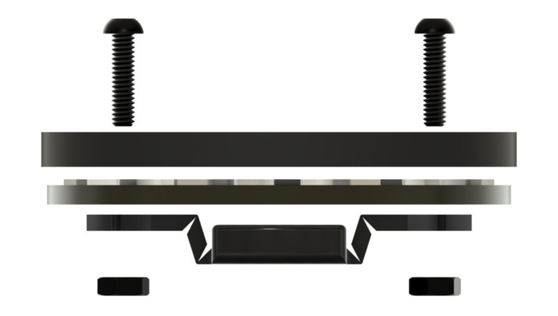

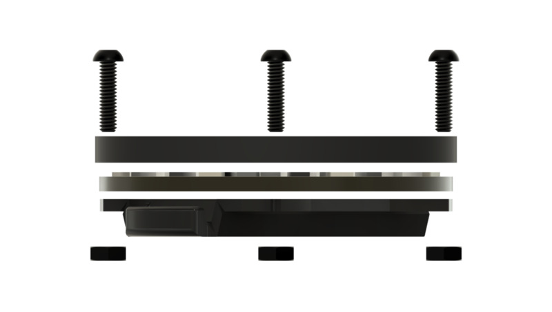

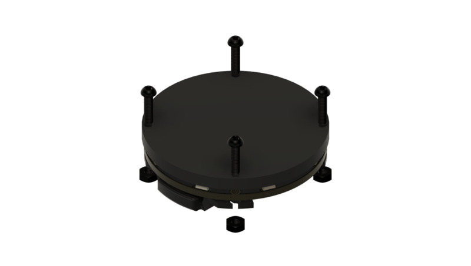

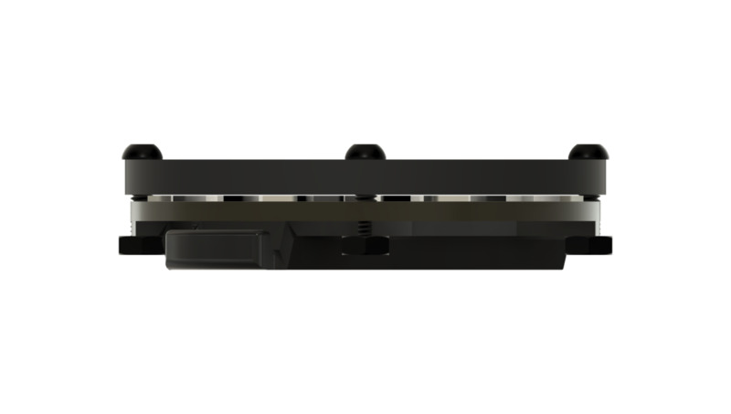

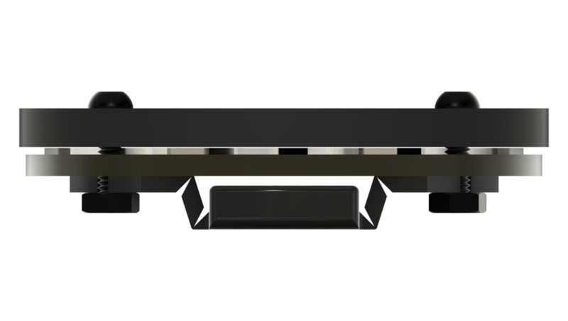

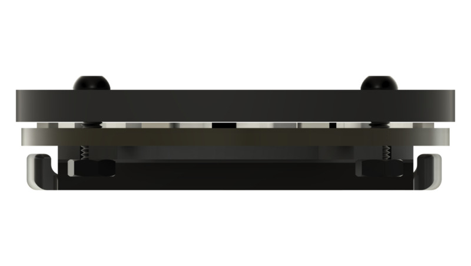

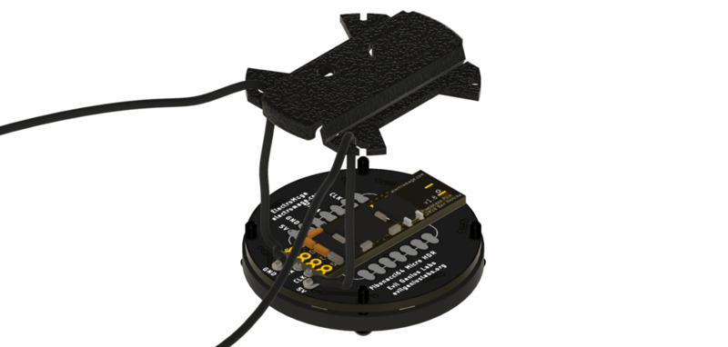

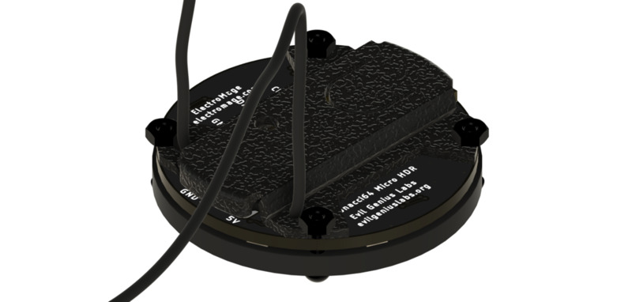

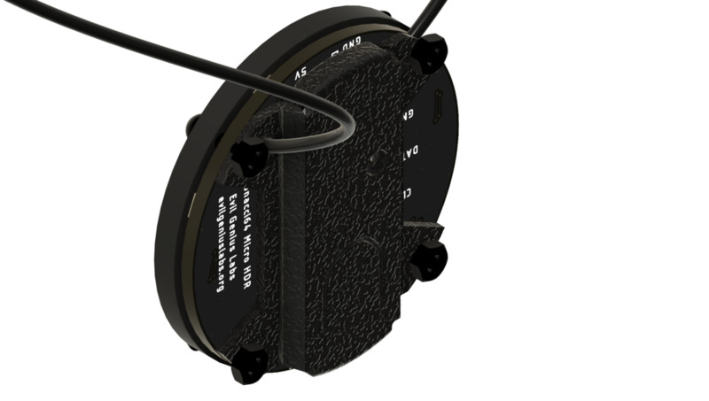

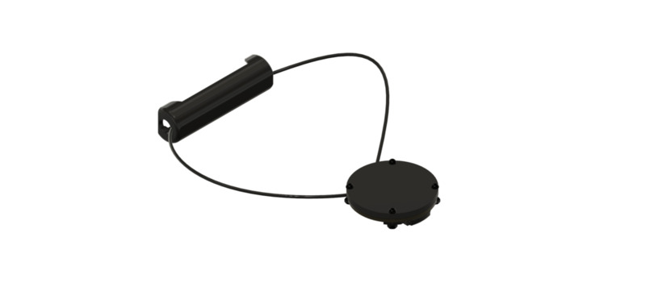

### Assembly Instructions

**Note**: Double-check the position, alignment, and orientation of each component very carefully before soldering!

If you're new to soldering, I highly recommend reading through a good soldering tutorial, such as the ones by [Adafruit](https://learn.adafruit.com/adafruit-guide-excellent-soldering) and [SparkFun](https://learn.sparkfun.com/tutorials/how-to-solder-through-hole-soldering).

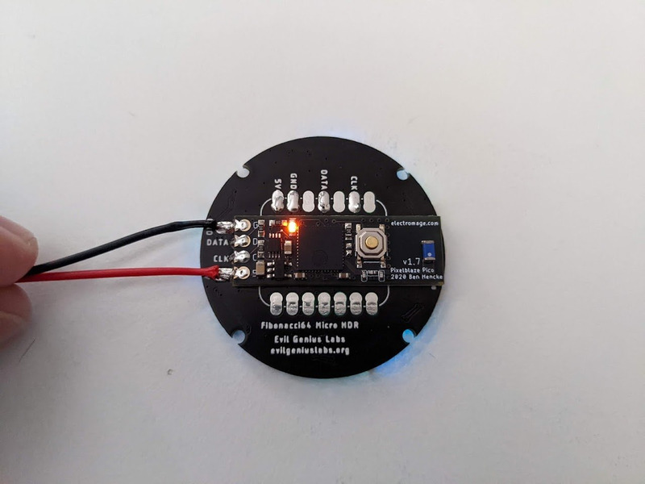

1. Find a clean spot on your soldering workspace. I used a piece of heavy card stock. Carefully place the board with the LEDs facing down and the bottom of the board facing up.
1. **VERY** carefully check polarity before connecting 5V and GND.
1. Either:

- Solder wires to the pads on the back of the Fibonacci PCB and connect them to your microcontroller.
- Or:
- Carefully align a Pixelblaze V3 Pico Adafruit QT Py, Seeeduino XIAO, or another controller with an identical footprint with the pads on the back of the Fibonacci PCB. Solder the pads.

1. Each WS2816C-2020 can theoretically draw 15mA at full brightness, solid white color. 64 of them can theoretically draw 960mA. I've found that 960mA is blindingly bright.
1. Keep an eye on the temperature of the PCB and especially the connectors. High temperatures can reduce the life of the LEDs. When possible, ensure air can flow, either passively (ventilation) or actively (exhaust fan).
1. If using a Pixelblaze V3 Pico, I suggest using the low power settings (reduce the global brightness, CPU clock speed, and/or disable wi-fi) to reduce power usage and heat.
1. If using FastLED, I suggest using its [power management](https://github.com/FastLED/FastLED/wiki/Power-notes#managing-power-in-fastled) to limit the maximum brightness to a reasonable amount, well under the maximum your power supply is rated for.
