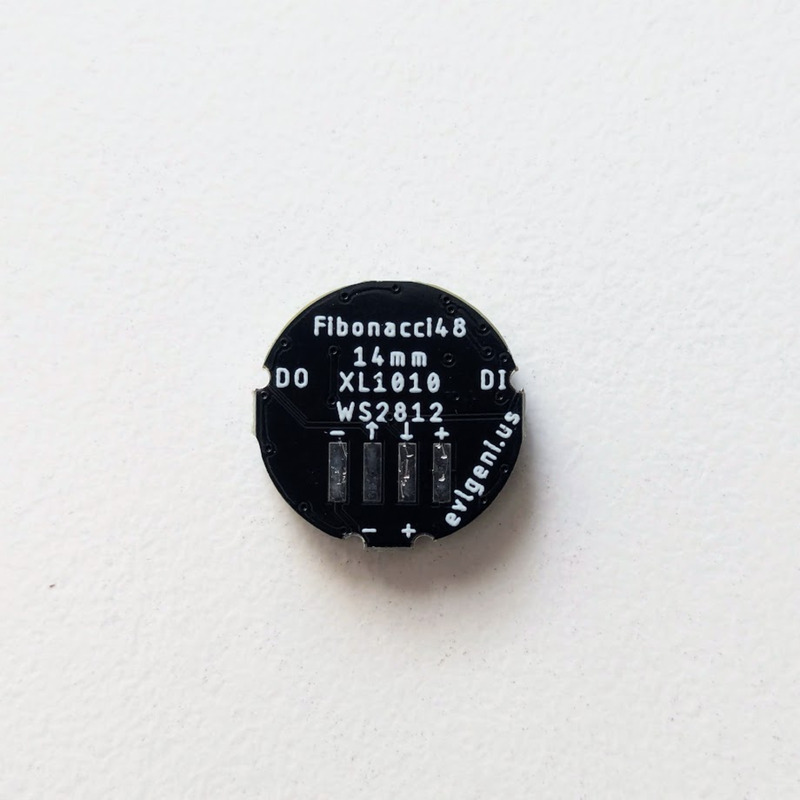
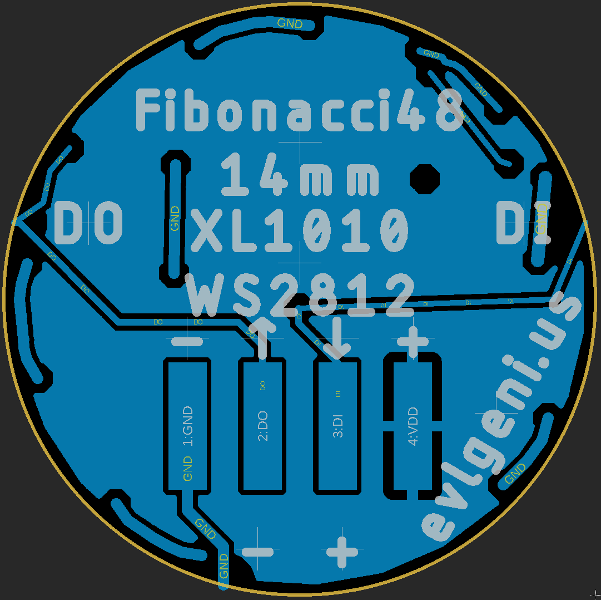

<h2>Table of Contents</h2>

- TOC
{:toc}

## Details

Fibonacci48 x 14mm is a tiny, beautiful circular disc with 48 RGB LEDs surface mounted in a Fibonacci distribution. Swirling and pulsing like a miniature galaxy, it's mesmerizing to watch.

It consists of 48 XL-1010RGBC-WS2812B 1mm² RGB LEDs, arranged into a circular <a href="https://en.wikipedia.org/wiki/Fermat%27s_spiral">Fermat's spiral</a> pattern.

It has solder pads on the back that match the pinout of the [TinyLily](https://tinycircuits.com/products/tinylily-mini-processor), although <b>WARNING</b>: I've had a hard time driving them with TinyLily when powered via small LIR coin cell batteries. The LEDs glitch at the upper-range of the batteries' voltage, but work fine at the lower end, or with a resistor inline with the power to drop the voltage.

It can be used with any microcontroller via the 5V, GND, and Data In pads. It also has a Data Out pad, for connecting more LEDs on the same data pin.



---

## Specifications

- Size: 0.55 x 0.55 x .063 inch (14 x 14 x 1.6 mm)
- 2 layer printed circuit board
- FR4 substrate
- Black SMOBC (solder mask over bare copper)
- HASL (Hot Air Solder Leveling) Finish
- Designed in the US by Evil Genius Labs

## Code

Open source touch demo: [https://github.com/jasoncoon/fibonacci48x14mmDemo](https://github.com/jasoncoon/fibonacci48x14mmDemo)

## Assembly Instructions

**Note**: Double-check the position, alignment, and orientation of each component very carefully before soldering!

If you're new to soldering, I highly recommend reading through a good soldering tutorial, such as the ones by [Adafruit](https://learn.adafruit.com/adafruit-guide-excellent-soldering) and [SparkFun](https://learn.sparkfun.com/tutorials/how-to-solder-through-hole-soldering).

**Note**: The order of the pads is:  <kbd>-</kbd> Ground, ⬆️ Data Out, ⬇️ Data In, <kbd>+</kbd> 5V

1. Find a clean spot on your soldering workspace. I used a piece of heavy card stock. Carefully place the board with the LEDs facing down and the bottom of the board facing up.
1. **VERY** carefully check polarity before connecting 5V and GND.
1. Either:

- Solder wires to the pads on the edge of the Fibonacci PCB and connect them to your microcontroller.
- Or:
- Carefully align a TinyLily, or another controller with an identical footprint with the pads on the back of the Fibonacci PCB. Solder the pads.

1. Each XL-1010RGBC-WS2812B can theoretically draw 15mA at full brightness, solid white color. 48 of them can theoretically draw 720mA. I've found tha is blindingly bright, and brightness should be drastically reduced to keep current draw and heat down.
1. Keep an eye on the temperature of the PCB and especially the connectors. High temperatures can reduce the life of the LEDs. When possible, ensure air can flow, either passively (ventilation) or actively (exhaust fan).
1. If using FastLED, I suggest using its [power management](https://github.com/FastLED/FastLED/wiki/Power-notes#managing-power-in-fastled) to limit the maximum brightness to a reasonable amount, well under the maximum your power supply is rated for.
