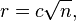
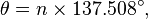
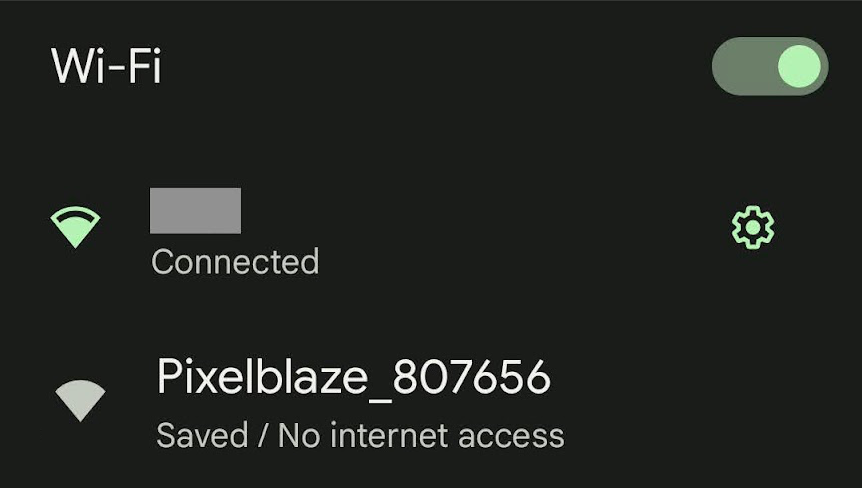
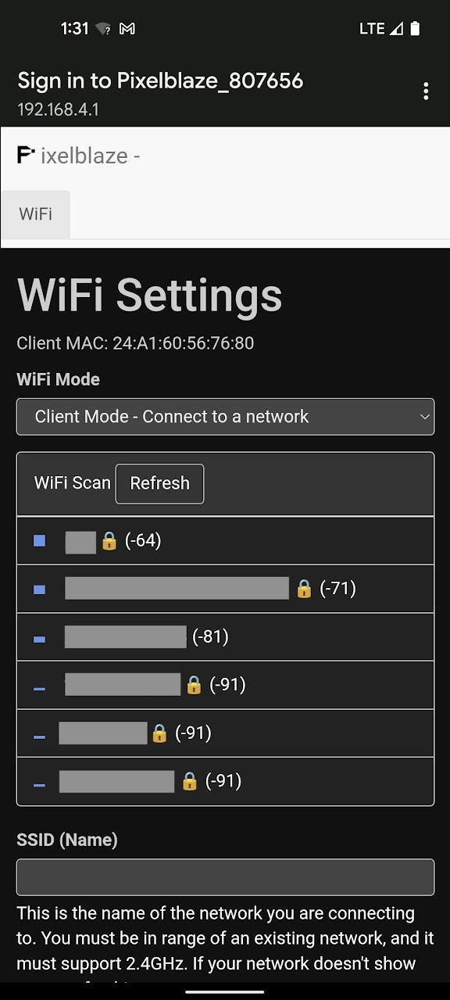
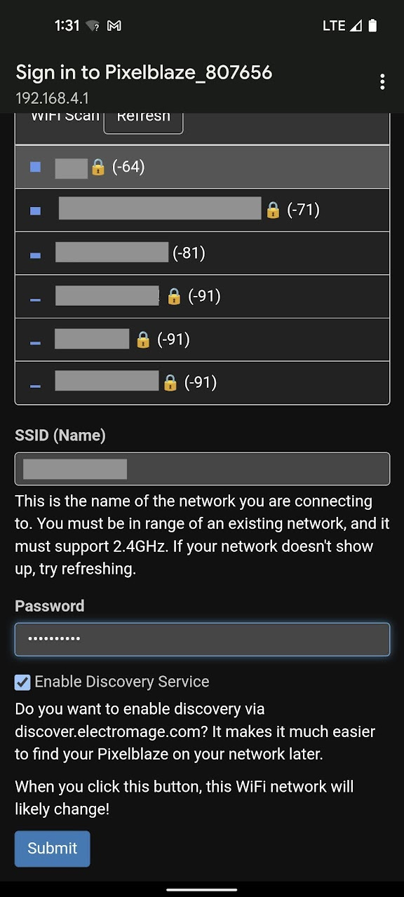
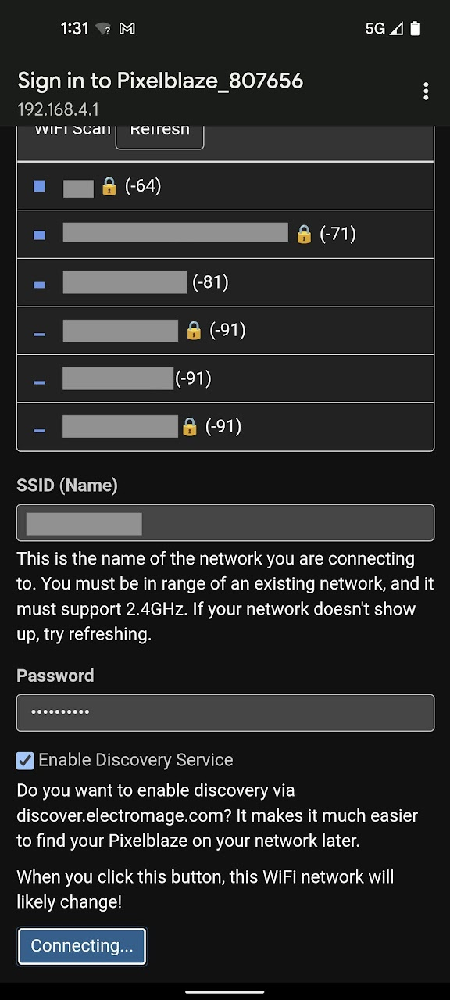

<h3>Table of Contents</h3>

- TOC
{:toc}

### Details

Fibonacci256 Puck is a beautiful, motion-sensitive 75mm circular disc with 256 RGB LEDs surface mounted in a Fibonacci distribution.  Swirling and pulsing like a colorful galaxy, it's mesmerizing to watch.

It consists of 256 RGB LEDs, arranged into a circular <a href="https://en.wikipedia.org/wiki/Fermat%27s_spiral">Fermat's spiral</a> pattern.

<!--  -->

In disc <a href="https://en.wikipedia.org/wiki/Phyllotaxis" title="Phyllotaxis">phyllotaxis</a>, as in the <a href="https://en.wikipedia.org/wiki/Sunflower" title="Sunflower" class="mw-redirect">sunflower</a> and daisy, the mesh of spirals occurs in <a href="https://en.wikipedia.org/wiki/Fibonacci_number" title="Fibonacci number">Fibonacci numbers</a> because divergence (angle of succession in a single spiral arrangement) approaches the <a href="https://en.wikipedia.org/wiki/Golden_ratio" title="Golden ratio">golden ratio</a>. The shape of the spirals depends on the growth of the elements generated sequentially. In mature-disc <a href="https://en.wikipedia.org/wiki/Phyllotaxis" title="Phyllotaxis">phyllotaxis</a>, when all the elements are the same size, the shape of the spirals is that of Fermat spirals—ideally. That is because Fermat's spiral traverses equal <a href="https://en.wikipedia.org/wiki/Annulus_(mathematics)" title="Annulus (mathematics)">annuli</a> in equal turns. The full model proposed by H Vogel in 1979<a href="https://en.wikipedia.org/wiki/Fermat%27s_spiral#cite_note-2">[2]</a> is

<dl>
<dd></dd>
</dl>
<dl>
<dd></dd>
</dl>

where <i>θ</i> is the angle, <i>r</i> is the radius or distance from the center, and <i>n</i> is the index number of the floret and <i>c</i> is a constant scaling factor. The angle 137.508° is the <a href="https://en.wikipedia.org/wiki/Golden_angle" title="Golden angle">golden angle</a> which is approximated by ratios of <a href="https://en.wikipedia.org/wiki/Fibonacci_number" title="Fibonacci number">Fibonacci numbers</a>.<a href="https://en.wikipedia.org/wiki/Fermat%27s_spiral#cite_note-3">[3]</a>

Fermat's spiral. (2015, October 24).  In <i>Wikipedia, The Free Encyclopedia</i>. Retrieved 02:45, February 24, 2016, from <a class="external free" href="https://en.wikipedia.org/w/index.php?title=Fermat%27s_spiral">https://en.wikipedia.org/w/index.php?title=Fermat%27s_spiral</a>

---

### The Internal Button and Status Light

Your Fibonacci Puck has a Pixelblaze Pico inside. The Pixelblaze has a push button and status LED on it. The button can be clicked once to move to the next pattern, enter setup mode, etc.

To press the button, place your thumb on the center of the front display and your middle finger on the back of the puck. Quickly squeeze and release the puck to press the button. You may not hear a "click", but you'll know it's worked if it moves to the next pattern.

The button can also be used to enter setup mode, enable WiFi if it's been disabled in the Settings, etc. Look into the opening where the power switch is, then squeeze and hold. After a few seconds you should see the orange status light inside.

### Connecting

Your Fibonacci should automatically play a playlist of pre-selected patterns endlessly.

For more control, you can connect to it via wi-fi.

To connect your Fibonacci to a wi-fi network:

1. If not already connected to a wi-fi network, your Fibonacci will create its own network named Pixelblaze_XXXXXXX,
   where XXXXX is a code unique to your Fibonacci. You should see it in the list of wi-fi networks available on
   a computer or mobile device:

   

   **Note:** If you can't find the Fibonacci's wi-fi network, it may not be in setup mode.

   To put it in to setup mode:
   1. Press and hold the button for 5 seconds.
   1. If the status LED on the back flashes 3 times, it's now in setup mode.
   1. If the status LED on the back flashes once, press and hold the button for 5 more seconds.
      The status LED on the back should now flash 3 times,
   1. It should now be in setup mode and its wi-fi network should now appear in the list on your computer or mobile device.

1. Connect to this network from a computer or mobile device.
1. You should see a pop-up and/or automatically get redirected to configure the Fibonacci's wi-fi settings.
   If not, open a browser and go to [http://192.168.4.1](http://192.168.4.1)

   

In WiFi Settings you an configure your Fibonacci to run in one of two modes:

---

Client Mode - Connect to a network

In this mode your Fibonacci can connect to an existing wi-fi network.
Use this mode while at home or another location with an existing wi-fi network that you can connect to.

1. Choose the wi-fi network to which you'd like to connect, or enter the SSID (Name) if you know it, it's hidden, etc.

   

1. Enter the password for the wi-fi network.
1. Leave **Enable Discovery Service** enabled to use the [Pixelblaze Discovery Service](http://discover.electromage.com),
   which makes it much easier to find your Pixelblaze on your wi-fi network later.
1. Click Submit to connect.

   

1. Once it has connected, it will have an IP address on your wi-fi network.
1. The computer or mobile device you're using should automatically re-connect to its previous network (your home wi-fi, mobile data, etc).
1. If you left it enabled, use the [Pixelblaze Discovery Service](http://discover.electromage.com) to find your Fibonacci.
1. If you're unable to find your Fibonacci's IP address, you can use [these instructions for finding a Raspberry Pi](https://www.raspberrypi.org/documentation/remote-access/ip-address.md).

---

AP Mode - Create a stand-alone network

In this mode your Fibonacci will create its own wi-fi network that you can connect to from another device.
Use this mode when outdoors or away from other wi-fi networks.

If you've already chosen **Client Mode** and followed the instructions above, skip down to [**Next Steps**](#settings)

1. Enter an SSID (Name).
   This is the name of the wi-fi network that you will connect to from other devices to configure your Fibonacci.
1. Enter a password at least 8 characters long. Passwords with fewer than 8 characters will not work.
1. Now you should be able to use a computer or mobile device to connect to the wi-fi network with the SSID (name)
   you entered in step one above.
1. Once connected, open a browser and enter the address [http://192.168.4.1](http://192.168.4.1)

---

### Settings

After you've gotten your Fibonacci connected to a wi-fi network,
there are a few settings you should check and be aware of.

Open your Fibonacci's web app and click on the **Settings** tab.

We won't go over every setting on this page, just the ones that are important for the use of your Fibonacci.

- Name: you can give your Fibonacci a unique name to differentiate it from others. This is especially useful if you have multiple Fibonaccis and/or Pixelblaze controllers on the same network.
- LED Settings:
- Limit Brightness: **Warning!** we recommend you keep this **at or below 50%!**
  It is possible for high brightnesses and patterns that use a lot of white or desaturated colors to draw a lot of power, potentially causing high temperatures and reducing the LED life time.

These settings should **always** be set to the following values to match the type and quantity of LEDs in your Fibonacci256:

- LED Type: WS2812
- Pixels: 256
- Color Order: GRB

To increase battery life `Power saving > CPU speed` is set to 160MHz. To further increase battery life, you can set it to 80MHz but some patterns will run at a much lower framerate and may appear "choppy".

You can increase battery life further by checking `Disable WiFi on startup`, but this does make the device hard to reach again. With this option checked, to bring WiFi back for one session, look into the opening where the power switch is, and squeeze and hold the puck for five seconds. You should see the orange status LED inside flash twice.

---

### Mapper

You shouldn't need to change anything on the **Mapper** tab.
This page just contains the pixel map, which is the location of each of your Fibonacci's LEDs. It's used by the Pixelblaze controller in patterns.

If you ever do need to reset to the Fibonacci's default map, use these values:

  

    <h4 class="accordion-header" id="headingOne"><button class="accordion-button collapsed" type="button" data-toggle="collapse" data-target="#collapseOne" aria-expanded="false" aria-controls="collapseOne">Pixelblaze Map (click to expand)</button></h4>
    

      

<pre>[[36.01,37.6],[27.45,36.24],[23.72,33.81],[21.41,30.75],[20.15,27.28],[19.81,23.57],[20.35,19.79],[21.71,16.06],[23.84,12.52],[26.68,9.3],[30.18,6.5],[34.24,4.25],[38.76,2.61],[46.02,4.57],[41.36,5.26],[37.04,6.65],[33.17,8.67],[29.86,11.23],[27.19,14.25],[25.26,17.62],[24.15,21.2],[23.96,24.89],[24.81,28.54],[26.98,32.04],[31.54,35.4],[30.73,31.84],[28.51,27.61],[28.01,23.72],[28.69,20.08],[30.3,16.75],[32.7,13.81],[35.78,11.36],[39.42,9.49],[43.5,8.27],[47.9,7.76],[52.49,7.99],[57.16,9.01],[66.23,17.14],[62.17,14.51],[57.89,12.64],[53.54,11.54],[49.22,11.21],[45.09,11.64],[41.28,12.81],[37.91,14.66],[35.12,17.14],[33.08,20.21],[31.97,23.84],[32.15,28.14],[35.06,34.33],[35.33,30.47],[35.44,25.22],[36.98,21.5],[39.42,18.68],[42.5,16.64],[46.05,15.39],[49.92,14.91],[53.96,15.23],[58.03,16.33],[62,18.2],[65.74,20.82],[69.12,24.13],[72.39,35.74],[70.36,31.39],[67.76,27.57],[64.67,24.35],[61.22,21.82],[57.51,20.04],[53.68,19.04],[49.88,18.87],[46.23,19.56],[42.9,21.17],[40.08,23.81],[38.02,27.88],[39.03,32.18],[42.03,26.94],[45.33,24.37],[48.89,23.14],[52.57,22.96],[56.24,23.72],[59.76,25.32],[63,27.68],[65.85,30.73],[68.21,34.39],[69.97,38.55],[71.07,43.11],[67.64,54.55],[68.23,49.83],[68.06,45.24],[67.15,40.93],[65.56,36.99],[63.37,33.56],[60.65,30.73],[57.51,28.63],[54.04,27.35],[50.34,27.05],[46.48,27.97],[42.39,30.74],[39.56,35.78],[46.15,31.63],[50.5,30.97],[54.25,31.7],[57.51,33.42],[60.25,35.95],[62.4,39.11],[63.91,42.79],[64.72,46.85],[64.79,51.16],[64.09,55.58],[62.61,59.99],[60.37,64.26],[53.68,67.73],[56.67,64.07],[58.92,60.13],[60.42,56.02],[61.14,51.88],[61.08,47.85],[60.24,44.05],[58.65,40.65],[56.33,37.79],[53.26,35.65],[49.34,34.5],[43.85,35.01],[46.78,37.22],[51.18,38.86],[54.13,41.41],[56.07,44.56],[57.12,48.12],[57.31,51.92],[56.68,55.81],[55.25,59.65],[53.05,63.31],[50.14,66.66],[46.58,69.59],[42.45,71.99],[35.02,71.32],[39.45,69.81],[43.42,67.69],[46.83,65.02],[49.6,61.91],[51.64,58.47],[52.89,54.83],[53.29,51.11],[52.75,47.47],[51.15,44.04],[48.17,40.98],[42.17,38.42],[44.31,41.51],[47.65,45.41],[48.99,49.19],[49.07,52.91],[48.15,56.48],[46.36,59.81],[43.81,62.77],[40.61,65.26],[36.85,67.19],[32.65,68.49],[28.12,69.08],[23.38,68.92],[13.1,62.55],[17.54,64.39],[22.05,65.46],[26.5,65.75],[30.77,65.29],[34.72,64.12],[38.23,62.27],[41.17,59.83],[43.41,56.87],[44.8,53.45],[45.13,49.61],[43.96,45.26],[40.35,42.96],[41.55,48.67],[40.82,52.76],[39.01,56.05],[36.39,58.64],[33.16,60.55],[29.48,61.74],[25.48,62.17],[21.31,61.84],[17.1,60.73],[12.98,58.84],[9.09,56.21],[3.88,45.44],[6.63,49.33],[9.86,52.6],[13.45,55.18],[17.28,57.02],[21.22,58.09],[25.14,58.35],[28.89,57.79],[32.32,56.4],[35.26,54.15],[37.51,50.91],[38.68,46.2],[37.27,41.07],[35.23,48.02],[32.46,51.38],[29.2,53.35],[25.62,54.25],[21.9,54.22],[18.16,53.32],[14.56,51.62],[11.23,49.16],[8.27,46.02],[5.8,42.27],[3.91,38.01],[2.68,33.34],[5.27,26.25],[5.54,30.97],[6.53,35.41],[8.19,39.46],[10.46,43.01],[13.22,45.96],[16.4,48.21],[19.87,49.66],[23.52,50.22],[27.22,49.76],[30.88,48],[34.54,44.07],[30.85,44.29],[26.54,45.97],[22.66,46.05],[19.11,45.01],[15.95,43.08],[13.25,40.39],[11.09,37.09],[9.56,33.28],[8.71,29.09],[8.6,24.64],[9.26,20.07],[10.69,15.5],[16.63,10.97],[14.37,15.07],[12.87,19.33],[12.15,23.6],[12.2,27.77],[13.01,31.7],[14.53,35.24],[16.74,38.26],[19.58,40.6],[23.06,42.08],[27.27,42.36],[33.21,40.38],[29.66,39.34],[24.67,38.67],[21.18,36.76],[18.63,34.06],[16.91,30.79],[16,27.12],[15.89,23.21],[16.58,19.2],[18.06,15.23],[20.3,11.44],[23.25,7.94],[26.86,4.86]]
        </pre>
      

    

  

---

### Patterns

Fibonacci comes with a wide variety of patterns built-in.
By default, it will automatically play a playlist of pre-selected patterns.

The sequencer can be configured via the web interface over wi-fi in the following ways:

Pattern sequencer options:

- <b><u>Off</u></b>: Continuously play your selected favorite pattern. You can manually move to the next pattern by clicking the button on the back.
- <b><u>Shuffle All</u></b>: randomly shuffle between all patterns after playing each one for an adjustable duration.
- <b><u>Playlist</u></b>: patterns can be arranged into a playlist with customizable order and duration for each pattern.

---

### PixelBlaze Settings

You can download this backup file <a href="/downloads/Fibonacci256 Puck.pbb">Fibonacci256 Puck.pbb</a> and restore it with the `Restore from backup` button at the bottom of the PixelBlaze web UI's Settings tab/page.

---

### Specifications

- Size: 2.95 x 2.95 x .748 inch (75 x 75 x 19 mm)
- 2 layer printed circuit board
- FR4 substrate
- Black SMOBC (solder mask over bare copper)
- HASL (Hot Air Solder Leveling) Finish
- Designed in the US by Evil Genius Labs

### FastLED Maps

  

    <h4 class="accordion-header" id="heading0One"><button class="accordion-button collapsed" type="button" data-toggle="collapse" data-target="#collapse0One" aria-expanded="false" aria-controls="collapse0One">FastLED Maps (click to expand)</button></h4>
    

      

        <pre>#define NUM_LEDS 256

byte coordsX[NUM_LEDS] = { 133, 164, 178, 186, 191, 192, 190, 185, 178, 167, 154, 140, 123, 96, 114, 129, 143, 156, 165, 172, 176, 177, 174, 166, 149, 152, 161, 162, 160, 154, 145, 134, 121, 106, 90, 73, 56, 23, 37, 53, 69, 85, 100, 114, 126, 136, 144, 148, 147, 137, 136, 135, 130, 121, 109, 96, 82, 67, 53, 38, 24, 12, 0, 7, 17, 28, 41, 54, 68, 82, 96, 108, 118, 126, 122, 111, 99, 86, 73, 59, 46, 34, 24, 15, 9, 5, 17, 15, 16, 19, 25, 33, 43, 54, 67, 81, 95, 110, 120, 96, 80, 66, 54, 44, 37, 31, 28, 28, 30, 36, 44, 68, 58, 49, 44, 41, 41, 44, 50, 59, 70, 84, 104, 94, 78, 67, 60, 56, 55, 57, 63, 71, 81, 94, 110, 137, 120, 106, 93, 83, 76, 71, 70, 72, 78, 89, 111, 103, 90, 86, 85, 89, 95, 105, 116, 130, 145, 162, 179, 217, 201, 184, 168, 152, 138, 125, 114, 106, 101, 100, 104, 117, 113, 115, 122, 132, 144, 157, 172, 187, 202, 217, 232, 251, 241, 229, 216, 202, 187, 173, 159, 147, 136, 128, 123, 128, 136, 146, 158, 171, 185, 198, 212, 224, 235, 244, 251, 255, 246, 245, 241, 235, 227, 216, 205, 192, 179, 165, 152, 138, 152, 168, 182, 195, 206, 216, 224, 230, 233, 233, 231, 226, 204, 212, 218, 220, 220, 217, 212, 204, 193, 180, 165, 143, 156, 175, 187, 197, 203, 206, 207, 204, 199, 191, 180, 167 };
byte coordsY[NUM_LEDS] = { 129, 124, 115, 103, 91, 77, 63, 49, 36, 25, 14, 6, 0, 7, 10, 15, 22, 32, 43, 55, 68, 82, 95, 108, 121, 107, 92, 78, 64, 52, 41, 32, 25, 21, 19, 20, 24, 53, 44, 37, 33, 32, 33, 37, 44, 53, 65, 78, 94, 117, 102, 83, 69, 59, 52, 47, 45, 46, 50, 57, 67, 79, 122, 106, 92, 80, 71, 64, 60, 60, 62, 68, 78, 93, 109, 89, 80, 75, 75, 78, 83, 92, 103, 117, 132, 149, 191, 174, 157, 141, 126, 114, 103, 96, 91, 90, 93, 103, 122, 107, 104, 107, 113, 123, 134, 148, 163, 178, 195, 211, 227, 239, 226, 211, 196, 181, 166, 152, 140, 129, 121, 117, 119, 127, 133, 143, 154, 167, 181, 196, 210, 223, 235, 246, 255, 253, 247, 239, 229, 218, 205, 192, 178, 165, 152, 141, 132, 143, 157, 171, 185, 198, 210, 221, 230, 237, 242, 244, 244, 220, 227, 231, 232, 230, 226, 219, 210, 199, 187, 173, 157, 148, 169, 184, 196, 206, 213, 217, 219, 218, 214, 207, 197, 157, 172, 184, 193, 200, 204, 205, 203, 198, 189, 178, 160, 141, 167, 179, 186, 190, 190, 186, 180, 171, 160, 146, 130, 113, 87, 104, 121, 135, 148, 159, 168, 173, 175, 173, 167, 152, 153, 159, 160, 156, 149, 139, 127, 113, 97, 81, 64, 47, 31, 46, 61, 77, 92, 107, 120, 131, 140, 145, 146, 139, 135, 133, 126, 116, 104, 90, 76, 61, 46, 32, 20, 8 };
byte angles[NUM_LEDS] = { 151, 131, 124, 118, 112, 106, 100, 94, 89, 83, 77, 71, 65, 56, 62, 68, 74, 80, 86, 92, 98, 104, 110, 118, 129, 113, 103, 96, 89, 83, 77, 70, 64, 58, 52, 46, 40, 24, 30, 36, 42, 48, 55, 61, 67, 74, 81, 88, 97, 120, 94, 80, 72, 64, 58, 51, 45, 39, 32, 26, 20, 15, 254, 5, 11, 17, 23, 29, 35, 41, 48, 55, 62, 73, 73, 53, 44, 37, 31, 25, 19, 13, 7, 1, 251, 245, 230, 236, 241, 247, 252, 3, 9, 14, 20, 27, 33, 42, 181, 21, 15, 10, 4, 253, 248, 243, 237, 232, 227, 222, 216, 208, 213, 218, 223, 228, 233, 238, 244, 249, 254, 3, 2, 244, 242, 238, 234, 229, 224, 219, 214, 209, 204, 199, 194, 186, 191, 196, 201, 206, 210, 215, 220, 224, 228, 231, 218, 217, 218, 215, 211, 207, 202, 197, 192, 188, 183, 178, 173, 160, 165, 170, 175, 180, 184, 189, 194, 198, 202, 206, 207, 195, 197, 194, 190, 186, 181, 176, 172, 167, 162, 157, 152, 139, 144, 149, 154, 159, 164, 168, 173, 178, 182, 186, 187, 175, 178, 174, 170, 165, 161, 156, 151, 146, 141, 136, 131, 125, 117, 123, 128, 133, 138, 143, 148, 153, 158, 162, 167, 170, 160, 155, 151, 146, 141, 135, 130, 125, 120, 114, 109, 103, 95, 100, 106, 111, 117, 122, 128, 133, 138, 143, 149, 155, 143, 137, 131, 125, 120, 114, 109, 103, 97, 92, 86, 80 };
byte radii[NUM_LEDS] = { 30, 82, 107, 126, 141, 154, 165, 176, 185, 194, 202, 210, 218, 209, 200, 192, 182, 173, 163, 152, 140, 126, 109, 88, 55, 64, 90, 109, 125, 138, 150, 161, 172, 182, 191, 201, 210, 214, 204, 193, 183, 172, 161, 150, 138, 124, 109, 92, 69, 32, 43, 72, 93, 110, 125, 139, 152, 164, 176, 187, 199, 210, 218, 206, 194, 182, 169, 156, 143, 128, 113, 96, 76, 50, 21, 57, 81, 101, 119, 134, 149, 163, 177, 190, 203, 216, 227, 214, 201, 187, 173, 158, 143, 127, 109, 89, 66, 35, 4, 49, 77, 100, 119, 137, 154, 169, 184, 199, 212, 225, 238, 237, 224, 210, 196, 181, 166, 149, 132, 112, 91, 64, 28, 49, 80, 105, 126, 145, 162, 178, 194, 208, 221, 234, 247, 243, 231, 219, 205, 190, 175, 158, 140, 120, 97, 68, 27, 52, 86, 112, 134, 153, 170, 186, 201, 215, 227, 239, 250, 255, 245, 234, 222, 210, 196, 181, 165, 147, 127, 103, 73, 52, 91, 118, 139, 158, 175, 190, 204, 216, 228, 238, 248, 249, 240, 231, 221, 209, 197, 183, 167, 150, 130, 106, 74, 43, 91, 119, 140, 158, 174, 188, 201, 212, 222, 231, 240, 248, 238, 230, 222, 213, 202, 191, 178, 164, 148, 128, 104, 69, 85, 114, 135, 152, 167, 180, 192, 202, 211, 219, 227, 234, 224, 216, 208, 200, 190, 180, 168, 155, 139, 120, 96, 56, 73, 103, 124, 141, 155, 167, 178, 188, 197, 205, 213, 220 };
</pre>

  

